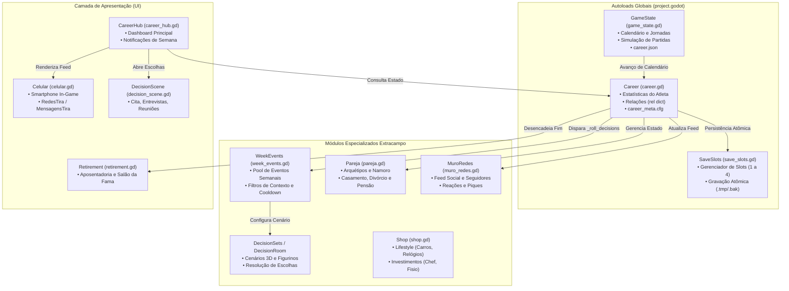
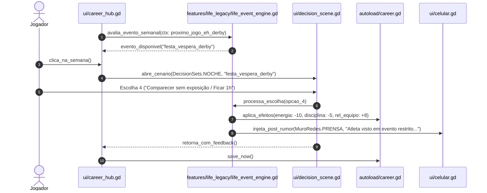

# FOOTBALL LEGACY | LIFE & LEGACY
## FASE 0 — AUDITORIA ARQUITETURAL COMPLETA E PLANO TÉCNICO

**Projeto:** Football Legacy Godot  
**Repositório:** `https://github.com/Play2703/football-legacy-godot`  
**Branch de Referência Técnica:** `etapa-4e18-r2`  
**Commit-Base Confirmado:** `25722c6bebc9747e15cfa888498996d54dc02cd8`  
**Branch de Trabalho (Auditoria Isolada):** `life-legacy-fase0-auditoria`  
**Motor e Linguagem:** Godot Engine v4.7.2.stable.arch_linux / GDScript 2.0  
**Data da Auditoria:** 07 de Novembro de 2026  
**Responsável Técnico:** Arquiteto de Software Sênior (Godot & Simulação Esportiva)

---

## 1. INTRODUÇÃO E ESCOPO DA FASE 0

O objetivo desta auditoria é realizar um levantamento estrutural e funcional aprofundado do codebase do **Football Legacy Godot** para fundamentar a futura concepção e integração do sistema **LIFE & LEGACY**.

> [!IMPORTANT]
> **REGRA FUNDAMENTAL DE PRESERVAÇÃO E ESCOPO:**
> Esta etapa é **estritamente diagnóstica e de planejamento (FASE 0)**. Nenhuma linha de código de produção, gameplay, física de partida ou persistência em disco foi alterada, adicionada ou removida. Todas as branches anteriores e saves legados permanecem intactos.

### 1.1. Verificação Formal do Blob `autoload/career.gd`
Em atendimento ao protocolo da auditoria:
- **Caminho:** `autoload/career.gd`
- **Tamanho Físico:** `1.278.450 bytes` (1,28 MB)
- **Extensão:** `66.548 linhas` de código GDScript
- **Git Blob SHA:** `6ae3532db10bd9fd86a9c9b16280e0d6e743da7c`
- **Classificação Arquitetural no Godot:** Registrado em `project.godot` como Autoload Singleton (`Career="*res://autoload/career.gd"`). Não possui `class_name Career` no topo por ser proibido no Godot 4 (a declaração `class_name` sobre um singleton gera o erro fatal do motor: `SCRIPT ERROR: Parse Error: Class "Career" hides an autoload singleton`).

---

## A. RESUMO EXECUTIVO

1. **Maturidade Arquitetural do Projeto:**
   O Football Legacy possui um ecossistema de simulação esportiva e extracampo consideravelmente mais rico do que uma análise superficial indicaria. Existem módulos consolidados para:
   - **Mídia Social Completa:** [`features/career/muro_redes.gd`](file:///home/pedro/.gemini/antigravity/scratch/football-legacy-godot/features/career/muro_redes.gd) (feed de posts, cálculo dinâmico de seguidores até 40M, reações, vozes de torcedores, rivais, companheiros e marcas).
   - **Interface de Smartphone:** [`ui/celular.gd`](file:///home/pedro/.gemini/antigravity/scratch/football-legacy-godot/ui/celular.gd) e [`ui/redes_tira.gd`](file:///home/pedro/.gemini/antigravity/scratch/football-legacy-godot/ui/redes_tira.gd) com suporte a aplicativos de feed, mensagens privadas, enquetes e provocações pós-jogos.
   - **Sistema de Relacionamentos Afetivos:** [`features/career/pareja.gd`](file:///home/pedro/.gemini/antigravity/scratch/football-legacy-godot/features/career/pareja.gd) (arquétipos de parceiras, namoro, noivado, casamento com custos proporcionais, divórcio, pensão alimentícia, acordo pré-nupcial, tensão doméstica e interferência de viagens).
   - **Motor de Decisões Semanal e Pós-Jogo:** [`features/career/week_events.gd`](file:///home/pedro/.gemini/antigravity/scratch/football-legacy-godot/features/career/week_events.gd), [`features/career/decision_sets.gd`](file:///home/pedro/.gemini/antigravity/scratch/football-legacy-godot/features/career/decision_sets.gd) e [`features/career/decision_room.gd`](file:///home/pedro/.gemini/antigravity/scratch/football-legacy-godot/features/career/decision_room.gd) com cenários 3D (prensa, vestiário, noite, casa, restaurante, assembleia) e indumentárias (uniforme, casual, terno).
   - **Estilo de Vida e Compras:** [`features/career/shop.gd`](file:///home/pedro/.gemini/antigravity/scratch/football-legacy-godot/features/career/shop.gd) com relógios de ouro, carros (compacto, SUV, esportivo), investimentos (chef particular, nutricionista, fisioterapeuta) com bônus e atritos com o técnico.

2. **Principais Lacunas Encontradas (O que NÃO Existe):**
   - **Paternidade e Filhos:** Zero suporte a filhos, nascimento, família expandida, criação ou dependentes.
   - **Dinastia e Sucessão Geracional:** Ao se aposentar em [`ui/retirement.gd`](file:///home/pedro/.gemini/antigravity/scratch/football-legacy-godot/ui/retirement.gd), o jogo apenas permite pendurar a placa no Hall da Fama ([`ui/salon_fama.tscn`](file:///home/pedro/.gemini/antigravity/scratch/football-legacy-godot/ui/salon_fama.tscn)) ou iniciar uma nova carreira independente via [`features/career/rebirth.gd`](file:///home/pedro/.gemini/antigravity/scratch/football-legacy-godot/features/career/rebirth.gd). Não há continuidade como filho do atleta.
   - **Indicadores Pessoais Unificados:** Atualmente, a estabilidade e percepção do atleta estão fragmentadas entre o dicionário `Career.rel` (tecnico, equipe, aficion, prensa, agente, patrocinador, pareja), `Career.energy` e propriedades derivadas. Não há indicadores autônomos para *Disciplina Profissional*, *Estabilidade Emocional*, *Influência Social* ou *Reputação Extracampo*.

3. **Riscos Críticos Identificados:**
   - **Acoplamento em `autoload/career.gd`:** O arquivo possui 66.548 linhas. Qualquer tentativa de adicionar centenas de funções diretamente dentro dele causará risco severo de regressão. O sistema Life & Legacy deve operar por **composição e adaptadores externos (módulos em `features/life_legacy/`)**.
   - **Dualidade de Persistência:** O jogo grava separadamente `career.json` (estado da liga/calendário via `GameState`) e `career_meta.cfg` (estado do jogador via `Career`). Dados do Life & Legacy devem ser acoplados de forma segura e não intrusiva em `career_meta.cfg` sob seção dedicada `[life_legacy]` ou arquivo complementar no slot.

---

## B. MAPA ARQUITETURAL DO SISTEMA ATUAL



---

## C. DIAGNÓSTICO DOS SEIS PILARES FUNCIONAIS

### Pilar 1 — Social Media & Public Image (Redes Sociais e Imagem Pública)
- **O que já existe:**
  - [`features/career/muro_redes.gd`](file:///home/pedro/.gemini/antigravity/scratch/football-legacy-godot/features/career/muro_redes.gd): Estrutura de feed completa com 30 posts (`MAX = 30`).
  - Categorização de autores: `HINCHA`, `RIVAL`, `PRENSA`, `COMPANERO`, `MARCA`, `YO`, `JUGADOR`, `FAN`.
  - Reações emoji: `APLAUSO`, `PITADA`, `FUEGO`, `RISA`.
  - Cálculo de seguidores baseado no escalão de imprensa: `SEGUIDORES_NIVEL = [800, 12000, 150000, 1200000, 9000000]`, teto em `40.000.000` (linhas 36-38).
  - Componentes de UI: [`ui/redes_tira.gd`](file:///home/pedro/.gemini/antigravity/scratch/football-legacy-godot/ui/redes_tira.gd) (2.142 linhas) e [`ui/celular.gd`](file:///home/pedro/.gemini/antigravity/scratch/football-legacy-godot/ui/celular.gd) com renderização vertical e horizontal, avatares, fotos e rascunhos de resposta.
- **Lacunas:**
  - Falta integração com polêmicas pessoais (festas, paparazzi, vazamento de fotos, declarações fora de tom).
  - O jogador só posta em eventos pré-programados; não pode escolher sua estratégia de imagem (ex: 'low profile', 'estrela pop', 'atleta disciplinado').
- **Ação Recomendada:**
  - Reutilizar integralmente `MuroRedes` e `RedesTira`, injetando novos fatos (`hechos`) originados do motor Life & Legacy.

### Pilar 2 — Events & Personal Choices (Decisões Pessoais e Consequências)
- **O que já existe:**
  - Motor de eventos semanais: [`Career._roll_decisions()`](file:///home/pedro/.gemini/antigravity/scratch/football-legacy-godot/autoload/career.gd#L17948) e [`WeekEvents.roll()`](file:///home/pedro/.gemini/antigravity/scratch/football-legacy-godot/features/career/week_events.gd).
  - Cooldowns e antirrepetição: `decision_cooldown = DECISION_COOLDOWN` (linha 18013) e memória de eventos recentes `_remember_decision()`.
  - Execução de impactos: [`Career.resolve_decision()`](file:///home/pedro/.gemini/antigravity/scratch/football-legacy-godot/autoload/career.gd#L18971) e [`Career._apply_event_fx()`](file:///home/pedro/.gemini/antigravity/scratch/football-legacy-godot/autoload/career.gd#L19114).
  - Probabilidade e risco: `risk_chance(fx)`, `risk["win"]` e `risk["lose"]` (linhas 19120-19123).
- **Lacunas:**
  - O motor atual foca em eventos contratuais, atritos com técnicos e patrocinadores.
  - Não há encadeamento formal de longo prazo para escolhas pessoais (ex: uma amizade tóxica iniciada no ano 1 cobrar seu preço no ano 3).
- **Ação Recomendada:**
  - Criar o subsistema `LifeEventEngine` que atua em conjunto com o `WeekEvents`, compartilhando a apresentação em `decision_scene.gd`.

### Pilar 3 — Relationships & Family (Relacionamentos e Família)
- **O que já existe:**
  - Módulo [`features/career/pareja.gd`](file:///home/pedro/.gemini/antigravity/scratch/football-legacy-godot/features/career/pareja.gd): 1.307 linhas de lógica especializada.
  - Arquétipos de parceiras (`PERFILES`), interesse financeiro (`interes_de`), custo de casamento (`BODA_COSTE_FRAC = 0.06`), divórcio (`divorcio_p`), pensão de 5 temporadas (`PENSION_FRAC = 0.5`) e acordo pré-nupcial (`PRENUP_ESCUDO = 0.62`).
  - Tensão doméstica: `TENSION_MAX = 2.0`, `calma_de()`, impacto de viagens e mudanças de clube.
  - Cena de encontro e jantares: [`ui/cita.gd`](file:///home/pedro/.gemini/antigravity/scratch/football-legacy-godot/ui/cita.gd) (1.545 linhas).
- **Lacunas Críticas:**
  - **Inexistência de Filhos e Família:** O módulo `Pareja` encerra seu ciclo em divórcio ou casamento permanente. Não há geração de filhos, nascimento, escola, aniversários ou despesas familiares contínuas.
- **Ação Recomendada:**
  - Não reconstruir `Pareja.gd`. Estendê-lo por composição através de um novo módulo `FamilyManager` que adiciona a camada de gravidez, nascimento, infância e atributos herdáveis dos filhos.

### Pilar 4 — Lifestyle & Celebrity (Estilo de Vida e Celebridade)
- **O que já existe:**
  - Itens de luxo em [`features/career/shop.gd`](file:///home/pedro/.gemini/antigravity/scratch/football-legacy-godot/features/career/shop.gd#L100): relógio de ouro, carros compactos, SUVs, doação ao bairro e investimentos em profissionais de saúde domiciliar.
  - Relação custo/benefício: relógios aumentam imprensa (+14) e agente (+6), mas irritam o técnico (-4) e vestiário (-3).
- **Lacunas:**
  - Compras são passivas. Não há eventos atrelados ao uso dos bens (ex: acidente com esportivo, balada após compra de relógio, festa na mansão com presença de celebridades).
- **Ação Recomendada:**
  - Conectar os itens já adquiridos na `Shop` aos gatilhos de eventos extracampo do Life & Legacy.

### Pilar 5 — Rivalries & Football Drama (Rivalidades e Conflitos)
- **O que já existe:**
  - Piques em redes sociais: `MuroRedes.PIQUE_FINAL` e `RedesTira.BORRADORES_PIQUE`.
  - Provocações pré-jogo e tira-teima pós-clássico.
- **Lacunas:**
  - Falta persistência de 'inimigos pessoais' no futebol que transcendem os clubes (ex: um zagueiro rival que se torna desafeto de carreira e provoca o atleta na imprensa).
- **Ação Recomendada:**
  - Estruturar um registro de rivalidades ativas integrado ao banco de jogadores `Squad` e `Teams`.

### Pilar 6 — Dynasty & Next Generation (Dinastia e Sucessão Familiar)
- **O que já existe:**
  - Modifier `hijo_leyenda` em [`features/career/rebirth.gd`](file:///home/pedro/.gemini/antigravity/scratch/football-legacy-godot/features/career/rebirth.gd#L252) — concede pontos adicionais no New Game+, mas é puramente abstrato.
  - Aposentadoria em [`autoload/career.gd`](file:///home/pedro/.gemini/antigravity/scratch/football-legacy-godot/autoload/career.gd#L17105) (`retire()`) e [`ui/retirement.gd`](file:///home/pedro/.gemini/antigravity/scratch/football-legacy-godot/ui/retirement.gd).
- **Lacunas Críticas:**
  - O fluxo encerra o save e manda para `salon_fama.tscn` ou `new_career.tscn`. Não há transferência de linhagem para o filho crescido.
- **Ação Recomendada:**
  - Desenvolver o pipeline de **Transição de Gerações**: ao se aposentar tendo um filho em idade futebolística (16-18 anos), o jogador tem a opção de "Passar o Legado", gerando um novo atleta com DNA herdado (pele, cabelo, traços, afinidade de pé e posição) na mesma continuidade de save.

---

## D. DIAGNÓSTICO DOS SEIS INDICADORES INDEPENDENTES

Atualmente, o jogador possui em [`autoload/career.gd`](file:///home/pedro/.gemini/antigravity/scratch/football-legacy-godot/autoload/career.gd#L1721):
```gdscript
var rel: Dictionary = {
    "tecnico": 50, "equipo": 50, "aficion": 40,
    "prensa": 20, "agente": 40, "patrocinador": 0, "pareja": 0,
}
```
Para implementar os seis pilares sem causar conflitos com o gameplay existente, os **seis indicadores independentes** devem ser modelados em um registro autônomo `life_stats: Dictionary`:

| Indicador | Equivalente Atual | Limites | Comportamento e Evolução | Risco de Duplicação | Estratégia de Modelagem |
| :--- | :--- | :---: | :--- | :--- | :--- |
| **1. Popularidade** | `rel["aficion"]` + seguidores em `MuroRedes` | 0 a 100 | Sobe com gols, carisma, declarações públicas e posts virais; cai com ostracismo esportivo. | Médio (já existe afición) | Manter `aficion` para torcida do clube atual e `Popularidade` como alcance global do atleta. |
| **2. Reputação** | `rel["prensa"]` | 0 a 100 | Reflete a respeitabilidade pública e moral do jogador perante a mídia e patrocinadores sérios. | Baixo | `rel["prensa"]` mede cobertura esportiva; `Reputação` mede caráter e seriedade ética. |
| **3. Disciplina Profissional** | Inexistente (fragmentada em multas) | 0 a 100 | Cai ao faltar treinos, sair em noitadas ou brigar com colegas; sobe com pontualidade e treinos extras. | Nenhum | Indicador novo essencial para balancear festas e noitadas. Afeta risco de lesões. |
| **4. Estabilidade Emocional** | `morale` (que apenas lê `rel["tecnico"]`) | 0 a 100 | Cai com divórcio, pressão de clássicos e crises familiares; sobe com vitórias e vida estável. | Baixo | Substitui o vínculo forçado de `morale = tecnico`, criando resiliência psicológica real. |
| **5. Relações Pessoais** | `rel["pareja"]` + vestiário | 0 a 100 | Harmonia dentro de casa (esposa, filhos, pais) e amizades íntimas fora dos gramados. | Baixo | Ampla escala que agrega parceira e ciclo familiar/amigos. |
| **6. Influência Social** | Inexistente (apenas escalão de imprensa) | 0 a 100 | Capacidade de ditar tendências, influenciar vestiário, patrocinadores e política do clube. | Nenhum | Permite desbloquear privilégios, como indicar contratações ou vetar transferências. |

---

## E. DIAGNÓSTICO DO MOTOR DE EVENTOS

### 1. Como o motor atual funciona:
1. **Disparo:** No início da semana esportiva ou após partida, `Career._roll_decisions()` chama `WeekEvents.roll(...)` passando o contexto esportivo (`_decision_ctx()`), patrocinadores e decisões recentes.
2. **Seleção:** `WeekEvents` filtra eventos elegíveis (`passes_ctx`), remove os que estão em cooldown (`_sin_recientes`) e escolhe um evento por probabilidade e peso.
3. **Apresentação:** O evento é guardado em `Career.week_event` ou `Career.pending_decision`. Ao clicar na semana no `CareerHub`, é aberta a cena 3D correspondente (`DecisionScene` ou `Cita`).
4. **Resolução:** A escolha é processada por `Career.resolve_decision()`, que aplica o efeito via `_apply_event_fx()` modificando dinheiro, energia e disparando `_apply_delta()` nas relações.

### 2. Avaliação de Abordagens para o Life & Legacy:

| Abordagem | Vantagens | Desvantagens | Veredito |
| :--- | :--- | :--- | :--- |
| **A. Arquivos JSON Puros** | Fácil de editar externamente, serialização nativa. | Sem tipagem, sem autocomplete, validação frágil em tempo de execução, lógica complexa requer strings de expressão. | Inadequado para regras complexas |
| **B. Godot Resources (.tres)** | Tipagem forte nativa do Godot, visualizável no Inspector. | Fragilidade de referências de UID ao mover arquivos; difícil manutenção em massa para centenas de micro-eventos. | Regular |
| **C. Dictionaries em GDScript (Estilo WeekEvents)** | Padrão já consagrado no projeto, compilação estática, altíssimo desempenho, facilidade de mesclar dados e lambdas de condição. | Arquivos muito grandes se centralizados em um único script. | Bom, mas precisa de modularização |
| **D. Módulos Declarativos GDScript Tipados (Recomendado)** | Combina a flexibilidade de Dictionaries com classes de esquema tipadas (`LifeEvent`, `LifeChoice`, `LifeEffect`) distribuídas em diretórios temáticos (`events/lifestyle/`, `events/family/`, etc.). | Exige pequenos scripts por categoria. | **ALTAMENTE RECOMENDADO** |

> [!TIP]
> **RECOMENDAÇÃO ARQUITETURAL:**
> Adotar a **Abordagem D**: uma arquitetura orientada a dados declarativos com classes GDScript leves para tipagem e validação, organizada em catálogos modulares por pilar. Isso impede o crescimento descontrolado de um único arquivo monolítico e preserva total compatibilidade com o padrão do projeto.

---

## F. DIAGNÓSTICO DE PERSISTÊNCIA E RETROCOMPATIBILIDADE

### 1. Fluxo Real de Persistência:
O salvamento ocorre por slot em `user://slot{N}/`:
- **`career.json`:** Gerenciado por `GameState._save()`, gravado via `SaveSlots.write_text_atomic()` (escrita em `.tmp` seguida de renomeação atômica). Armazena partidas, gols, calendário e histórico de ligas.
- **`career_meta.cfg`:** Gerenciado por `Career._save()`, gravado via `SaveSlots.save_cfg_atomic()` utilizando a API nativa `ConfigFile` do Godot. Armazena a identidade do jogador, atributos, inventário, decisões e histórico de parceira.

### 2. Estratégia de Retrocompatibilidade para o Life & Legacy:
Para garantir que **nenhum save existente seja quebrado ou corrompido**:
1. O Life & Legacy utilizará exclusivamente a API `ConfigFile` em `career_meta.cfg`, isolando todos os seus dados sob seções exclusivas:
   - `[life_legacy_stats]` (os 6 indicadores)
   - `[life_legacy_family]` (cônjuge estendido, árvore de filhos)
   - `[life_legacy_history]` (eventos e escolhas passadas)
2. **Migração Segura (Zero-Default Safe):**
   Ao carregar um save antigo via `Career._load()`:
   Se a seção `[life_legacy_stats]` não existir, o sistema instancia automaticamente os valores padrão (50 neutro para disciplina, estabilidade emocional, etc.) sem disparar erros ou modificar a estrutura esportiva legada.

---

## G. CENÁRIO DE REFERÊNCIA: FESTA NA VÉSPERA DO CLÁSSICO

Como requisito de auditoria, analisou-se o fluxo de ponta a ponta do cenário:
> *"O jogador recebe um convite para uma festa na véspera de um clássico importante."*



### Análise das Consequências Não-Lineares:
- **Opção 1 (Participar e curtir a noite):** Energia cai para 60%; Disciplina cai -15; Popularidade sobe +10; se no dia seguinte jogar mal, a imprensa (`rel["prensa"]`) cobra em dobro. Se marcar 2 gols no clássico, vira post lendário no feed ("Joga de ressaca e decide!").
- **Opção 2 (Recusar o convite):** Disciplina sobe +10; Estabilidade sobe +5; Popularidade extracampo cai -5; amigos famosos provocam no feed privado.
- **Opção 3 (Comparecer por pouco tempo):** Impacto mínimo de energia (-5); Disciplina inalterada; Relações Pessoais +10.
- **Opção 4 (Entrada discreta/camarote fechado):** Risco aleatório (20%) de um fã postar foto no `MuroRedes` gerando pequeno atrito com o treinador.

---

## H. MAPA COMPLETO DE ARQUIVOS E DEPENDÊNCIAS

| Arquivo | Responsabilidade Atual | Relação com Life & Legacy | Ação Futura Sugerida |
| :--- | :--- | :--- | :--- |
| [`autoload/career.gd`](file:///home/pedro/.gemini/antigravity/scratch/football-legacy-godot/autoload/career.gd) | Singleton do atleta, habilidades, decisões e persistência | Hub central do jogador, emite sinais de avanço e consome efeitos | **Manter intacto**; criar interface adaptadora externa sem alterar código legado |
| [`autoload/game_state.gd`](file:///home/pedro/.gemini/antigravity/scratch/football-legacy-godot/autoload/game_state.gd) | Calendário, dias, semanas, partidas e simulação da liga | Marca a passagem do tempo semanal e anual | **Manter intacto**; conectar aos sinais `calendar_advanced` |
| [`autoload/save_slots.gd`](file:///home/pedro/.gemini/antigravity/scratch/football-legacy-godot/autoload/save_slots.gd) | Gerenciador de slots, escrita atômica e backups | Provedor do caminho de save do slot ativo | **Manter intacto**; utilizar `slot_path()` para gravação segura |
| [`features/career/pareja.gd`](file:///home/pedro/.gemini/antigravity/scratch/football-legacy-godot/features/career/pareja.gd) | Arquétipos afetivos, casamento, divórcio e pensão | Base para o pilar de Família e Cônjuge | **Reutilizar** integralmente; estender via adaptador para gerar filhos |
| [`features/career/muro_redes.gd`](file:///home/pedro/.gemini/antigravity/scratch/football-legacy-godot/features/career/muro_redes.gd) | Feed social, contagem de seguidores e reações | Base para o pilar de Redes Sociais e Imagem Pública | **Reutilizar**; alimentar com novos fatos e narrativas extracampo |
| [`features/career/shop.gd`](file:///home/pedro/.gemini/antigravity/scratch/football-legacy-godot/features/career/shop.gd) | Bens de consumo, carros, relógios e profissionais | Base para o pilar de Estilo de Vida e Celebridade | **Reutilizar**; integrar posses de luxo como gatilhos de eventos |
| [`features/career/week_events.gd`](file:///home/pedro/.gemini/antigravity/scratch/football-legacy-godot/features/career/week_events.gd) | Banco de eventos e decisões de carreira esportiva | Referência estrutural do motor de eventos | **Manter intacto**; coexistir com o novo catálogo de eventos de vida |
| [`features/career/decision_sets.gd`](file:///home/pedro/.gemini/antigravity/scratch/football-legacy-godot/features/career/decision_sets.gd) | Definição de cenários 3D e roupas para decisões | Provedor visual dos encontros e reuniões | **Reutilizar**; cenários `NOCHE`, `RESTAURANTE`, `CASA` atendem perfeitamente |
| [`features/career/decision_room.gd`](file:///home/pedro/.gemini/antigravity/scratch/football-legacy-godot/features/career/decision_room.gd) | Sala 3D onde decisões são renderizadas | Cenário interativo de apresentação das escolhas | **Reutilizar** sem modificação |
| [`features/career/rebirth.gd`](file:///home/pedro/.gemini/antigravity/scratch/football-legacy-godot/features/career/rebirth.gd) | Sistema New Game+ com modificadores | Referência para herança de linhagem esportiva | **Adaptar/Estender** para o pilar de Dinastia (Próxima Geração) |
| [`ui/career_hub.gd`](file:///home/pedro/.gemini/antigravity/scratch/football-legacy-godot/ui/career_hub.gd) | Tela principal da carreira esportiva | Ponto de entrada de notificações de vida | **Criar Adaptador de UI** (novo botão/aba "Minha Vida" sem quebrar o Hub) |
| [`ui/celular.gd`](file:///home/pedro/.gemini/antigravity/scratch/football-legacy-godot/ui/celular.gd) | Smartphone in-game (apps de redes e mensagens) | Interface imersiva para o celular do jogador | **Ampliar** com novo app ou abas de vida pessoal |
| [`ui/decision_scene.gd`](file:///home/pedro/.gemini/antigravity/scratch/football-legacy-godot/ui/decision_scene.gd) | Controle de diálogo e botões de escolha | Tela padrão de apresentação de eventos | **Reutilizar** para apresentar escolhas do Life & Legacy |
| [`ui/retirement.gd`](file:///home/pedro/.gemini/antigravity/scratch/football-legacy-godot/ui/retirement.gd) | Cerimônia de aposentadoria do atleta | Ponto de transição para a próxima geração familiar | **Adaptar** para oferecer a opção "Continuar com o Filho" |

---

## I. CLASSIFICAÇÃO DE RISCOS TÉCNICOS

| Risco | Classificação | Impacto Potencial | Estratégia de Mitigação |
| :--- | :---: | :--- | :--- |
| **Monolitismo de `career.gd`** | **CRÍTICO** | Inserir mais código no arquivo de 66k linhas pode degradar performance de compilação e causar bugs colaterais. | **Regra Arquitetural:** O Life & Legacy residirá em pasta isolada `features/life_legacy/`, comunicando-se com `Career` apenas por sinais e adaptadores leves. |
| **Corrupção de Saves Legados** | **ALTO** | Saves antigos falharem ao carregar em novas versões do jogo. | Utilizar seções novas em `career_meta.cfg` com valores padrão de fallback (fail-safe zero-allocation). |
| **Duplicação de Lógica Existente** | **ALTO** | Recriar redes sociais, namoro ou lojas quando já existem no jogo. | Reuso estrito de `MuroRedes`, `Pareja`, `Shop` e `DecisionSets` conforme mapeado nesta auditoria. |
| **Desbalanceamento Esportivo** | **MÉDIO** | Indicadores de vida pessoal quebrarem a curva de progressão atlética. | Limitar os multiplicadores extracampo a influências sutis de moral, energia e foco, sem burlar o declínio atlético blindado na 4e.15. |
| **Sobrecarga de UI em Telas Móveis** | **BAIXO** | Falta de espaço na tela do `CareerHub` em resoluções verticais (Android). | Integrar o acesso através do aplicativo já existente no `Celular.gd`, mantendo a HUD do Hub limpa. |

---

## J. PLANO TÉCNICO PROPOSTO PARA A FASE 1

### 1. Arquitetura Modular Proposta (Sem Modificar Produção):
```
res://features/life_legacy/
├── core/
│   ├── life_stats.gd          # Gerenciador dos 6 indicadores independentes
│   ├── life_event_engine.gd   # Motor de eventos encadeados e condicionais
│   └── life_persistence.gd    # Mapeador de gravação limpa no career_meta.cfg
├── models/
│   ├── life_event.gd          # Classe tipada de evento (ID, título, escolhas, pesos)
│   ├── life_choice.gd         # Classe tipada de opção e consequências
│   └── family_member.gd       # Modelo de parente (cônjuge, filho, filha, atributos)
├── data/
│   ├── events_lifestyle.gd    # Catálogo declarativo: estilo de vida e festas
│   ├── events_family.gd       # Catálogo declarativo: casamento e filhos
│   └── events_scandal.gd      # Catálogo declarativo: imprensa e polêmicas
└── legacy/
    └── dynasty_manager.gd     # Lógica de herança genética e transição geracional
```

### 2. Sequência de Implementação Recomendada:
1. **Passo 1 — Core de Indicadores:** Criar `life_stats.gd` com valores [0-100] e persistência retrocompatível.
2. **Passo 2 — Motor de Eventos:** Implementar `life_event_engine.gd` com suporte a condições e cooldowns.
3. **Passo 3 — Catálogo Piloto:** Implementar o evento de referência (Festa na Véspera do Clássico).
4. **Passo 4 — Integração no Smartphone:** Conectar as notificações ao `Celular.gd` sem poluir a HUD esportiva.
5. **Passo 5 — Sucessão Dinástica:** Implementar `family_member.gd` e a opção de continuidade pós-aposentadoria.

---

## K. CONCLUSÃO TÉCNICA E DECISÕES PARA APROVAÇÃO

### Veredito do Arquiteto:
A arquitetura do **Football Legacy Godot** está **tecnicamente apta e pronta** para receber a FASE 1 do sistema LIFE & LEGACY. Os alicerces visuais, narrativos e de simulação já presentes no projeto permitirão uma implementação elegante, sem reinventar a roda e sem risco de regressão.

### Decisões Submetidas à Aprovação do Usuário:
1. **Ponto de Acesso na Interface:** Aprova que o acesso ao Life & Legacy ocorra primariamente através do Smartphone In-Game (`Celular.gd`), complementado por um atalho no `CareerHub`?
2. **Arquitetura de Dados dos Eventos:** Aprova a adoção de Catálogos Declarativos GDScript Tipados organizados por pilar em `features/life_legacy/data/`?
3. **Autorização para FASE 1:** Autoriza o início da modelagem e criação dos componentes estruturais da Fase 1 na branch `life-legacy-fase0-auditoria`?

---
*Relatório finalizado em conformidade com o protocolo. Aguardando autorização para avançar.*
