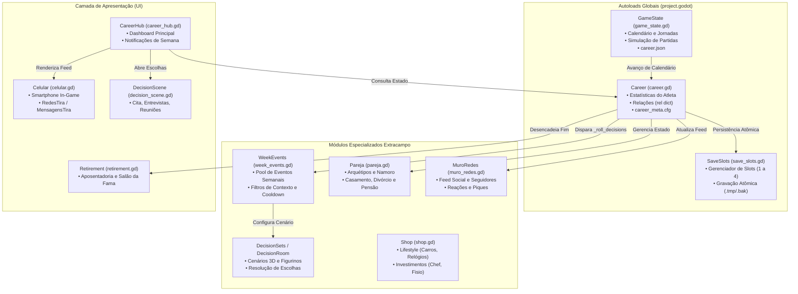
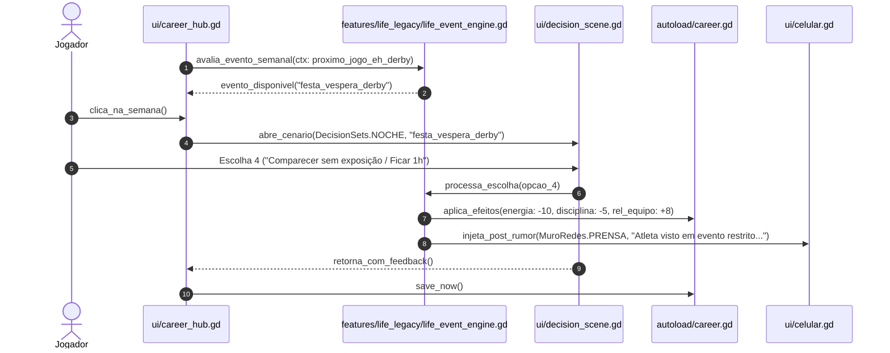
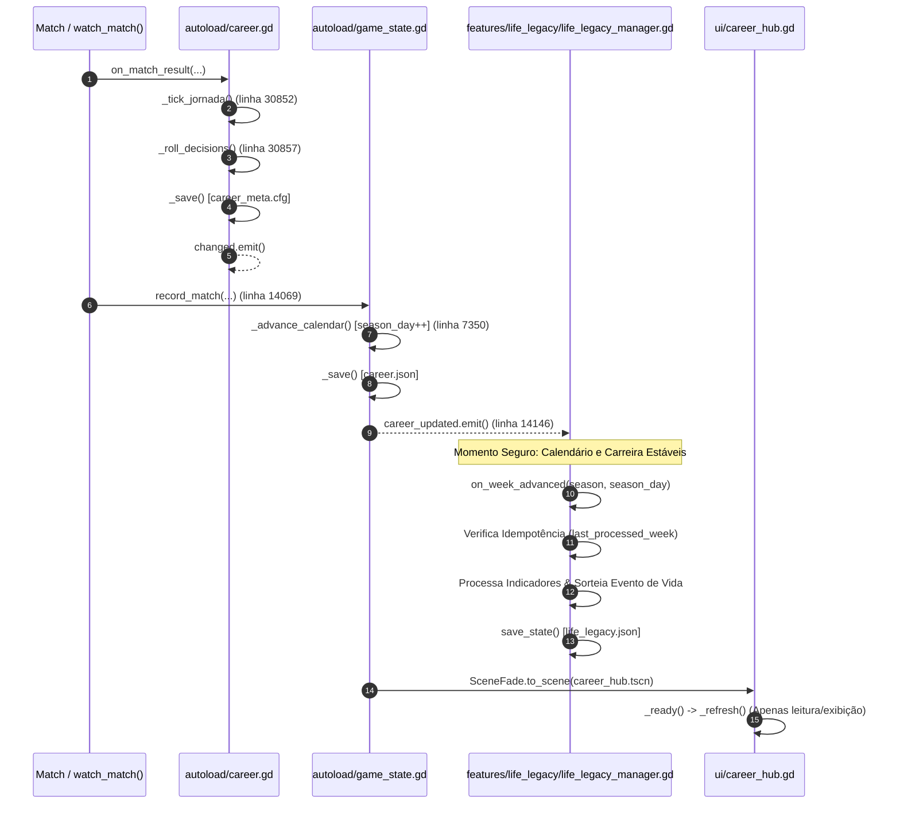
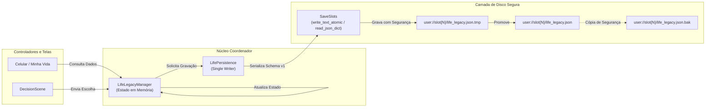
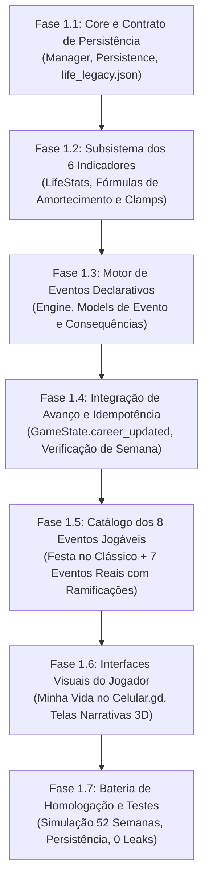

# FOOTBALL LEGACY | LIFE & LEGACY
## FASE 0 — AUDITORIA ARQUITETURAL COMPLETA E PLANO TÉCNICO

**Projeto:** Football Legacy Godot  
**Repositório:** `https://github.com/Play2703/football-legacy-godot`  
**Branch de Referência Técnica:** `etapa-4e18-r2`  
**Commit-Base Confirmado:** `25722c6bebc9747e15cfa888498996d54dc02cd8`  
**Branch de Trabalho (Auditoria Isolada):** `life-legacy-fase0-auditoria`  
**Motor e Linguagem:** Godot Engine v4.7.2.stable.arch_linux / GDScript 2.0  
**Data da Auditoria:** 07 de Novembro de 2026  
**Responsável Técnico:** Arquiteto de Software Sênior (Godot & Simulação Esportiva)

---

## 1. INTRODUÇÃO E ESCOPO DA FASE 0

O objetivo desta auditoria é realizar um levantamento estrutural e funcional aprofundado do codebase do **Football Legacy Godot** para fundamentar a futura concepção e integração do sistema **LIFE & LEGACY**.

> [!IMPORTANT]
> **REGRA FUNDAMENTAL DE PRESERVAÇÃO E ESCOPO:**
> Esta etapa é **estritamente diagnóstica e de planejamento (FASE 0)**. Nenhuma linha de código de produção, gameplay, física de partida ou persistência em disco foi alterada, adicionada ou removida. Todas as branches anteriores e saves legados permanecem intactos.

### 1.1. Verificação Formal do Blob `autoload/career.gd`
Em atendimento ao protocolo da auditoria:
- **Caminho:** `autoload/career.gd`
- **Tamanho Físico:** `1.278.450 bytes` (1,28 MB)
- **Extensão:** `66.548 linhas` de código GDScript
- **Git Blob SHA:** `6ae3532db10bd9fd86a9c9b16280e0d6e743da7c`
- **Classificação Arquitetural no Godot:** Registrado em `project.godot` como Autoload Singleton (`Career="*res://autoload/career.gd"`). Não possui `class_name Career` no topo por ser proibido no Godot 4 (a declaração `class_name` sobre um singleton gera o erro fatal do motor: `SCRIPT ERROR: Parse Error: Class "Career" hides an autoload singleton`).

---

## A. RESUMO EXECUTIVO

1. **Maturidade Arquitetural do Projeto:**
   O Football Legacy possui um ecossistema de simulação esportiva e extracampo consideravelmente mais rico do que uma análise superficial indicaria. Existem módulos consolidados para:
   - **Mídia Social Completa:** [`features/career/muro_redes.gd`](file:///home/pedro/.gemini/antigravity/scratch/football-legacy-godot/features/career/muro_redes.gd) (feed de posts, cálculo dinâmico de seguidores até 40M, reações, vozes de torcedores, rivais, companheiros e marcas).
   - **Interface de Smartphone:** [`ui/celular.gd`](file:///home/pedro/.gemini/antigravity/scratch/football-legacy-godot/ui/celular.gd) e [`ui/redes_tira.gd`](file:///home/pedro/.gemini/antigravity/scratch/football-legacy-godot/ui/redes_tira.gd) com suporte a aplicativos de feed, mensagens privadas, enquetes e provocações pós-jogos.
   - **Sistema de Relacionamentos Afetivos:** [`features/career/pareja.gd`](file:///home/pedro/.gemini/antigravity/scratch/football-legacy-godot/features/career/pareja.gd) (arquétipos de parceiras, namoro, noivado, casamento com custos proporcionais, divórcio, pensão alimentícia, acordo pré-nupcial, tensão doméstica e interferência de viagens).
   - **Motor de Decisões Semanal e Pós-Jogo:** [`features/career/week_events.gd`](file:///home/pedro/.gemini/antigravity/scratch/football-legacy-godot/features/career/week_events.gd), [`features/career/decision_sets.gd`](file:///home/pedro/.gemini/antigravity/scratch/football-legacy-godot/features/career/decision_sets.gd) e [`features/career/decision_room.gd`](file:///home/pedro/.gemini/antigravity/scratch/football-legacy-godot/features/career/decision_room.gd) com cenários 3D (prensa, vestiário, noite, casa, restaurante, assembleia) e indumentárias (uniforme, casual, terno).
   - **Estilo de Vida e Compras:** [`features/career/shop.gd`](file:///home/pedro/.gemini/antigravity/scratch/football-legacy-godot/features/career/shop.gd) com relógios de ouro, carros (compacto, SUV, esportivo), investimentos (chef particular, nutricionista, fisioterapeuta) com bônus e atritos com o técnico.

2. **Principais Lacunas Encontradas (O que NÃO Existe):**
   - **Paternidade e Filhos:** Zero suporte a filhos, nascimento, família expandida, criação ou dependentes.
   - **Dinastia e Sucessão Geracional:** Ao se aposentar em [`ui/retirement.gd`](file:///home/pedro/.gemini/antigravity/scratch/football-legacy-godot/ui/retirement.gd), o jogo apenas permite pendurar a placa no Hall da Fama ([`ui/salon_fama.tscn`](file:///home/pedro/.gemini/antigravity/scratch/football-legacy-godot/ui/salon_fama.tscn)) ou iniciar uma nova carreira independente via [`features/career/rebirth.gd`](file:///home/pedro/.gemini/antigravity/scratch/football-legacy-godot/features/career/rebirth.gd). Não há continuidade como filho do atleta.
   - **Indicadores Pessoais Unificados:** Atualmente, a estabilidade e percepção do atleta estão fragmentadas entre o dicionário `Career.rel` (tecnico, equipe, aficion, prensa, agente, patrocinador, pareja), `Career.energy` e propriedades derivadas. Não há indicadores autônomos para *Disciplina Profissional*, *Estabilidade Emocional*, *Influência Social* ou *Reputação Extracampo*.

3. **Riscos Críticos Identificados:**
   - **Acoplamento em `autoload/career.gd`:** O arquivo possui 66.548 linhas. Qualquer tentativa de adicionar centenas de funções diretamente dentro dele causará risco severo de regressão. O sistema Life & Legacy deve operar por **composição e adaptadores externos (módulos em `features/life_legacy/`)**.
   - **Dualidade de Persistência:** O jogo grava separadamente `career.json` (estado da liga/calendário via `GameState`) e `career_meta.cfg` (estado do jogador via `Career`). Dados do Life & Legacy devem ser acoplados de forma segura e não intrusiva em `career_meta.cfg` sob seção dedicada `[life_legacy]` ou arquivo complementar no slot.

---

## B. MAPA ARQUITETURAL DO SISTEMA ATUAL



---

## C. DIAGNÓSTICO DOS SEIS PILARES FUNCIONAIS

### Pilar 1 — Social Media & Public Image (Redes Sociais e Imagem Pública)
- **O que já existe:**
  - [`features/career/muro_redes.gd`](file:///home/pedro/.gemini/antigravity/scratch/football-legacy-godot/features/career/muro_redes.gd): Estrutura de feed completa com 30 posts (`MAX = 30`).
  - Categorização de autores: `HINCHA`, `RIVAL`, `PRENSA`, `COMPANERO`, `MARCA`, `YO`, `JUGADOR`, `FAN`.
  - Reações emoji: `APLAUSO`, `PITADA`, `FUEGO`, `RISA`.
  - Cálculo de seguidores baseado no escalão de imprensa: `SEGUIDORES_NIVEL = [800, 12000, 150000, 1200000, 9000000]`, teto em `40.000.000` (linhas 36-38).
  - Componentes de UI: [`ui/redes_tira.gd`](file:///home/pedro/.gemini/antigravity/scratch/football-legacy-godot/ui/redes_tira.gd) (2.142 linhas) e [`ui/celular.gd`](file:///home/pedro/.gemini/antigravity/scratch/football-legacy-godot/ui/celular.gd) com renderização vertical e horizontal, avatares, fotos e rascunhos de resposta.
- **Lacunas:**
  - Falta integração com polêmicas pessoais (festas, paparazzi, vazamento de fotos, declarações fora de tom).
  - O jogador só posta em eventos pré-programados; não pode escolher sua estratégia de imagem (ex: 'low profile', 'estrela pop', 'atleta disciplinado').
- **Ação Recomendada:**
  - Reutilizar integralmente `MuroRedes` e `RedesTira`, injetando novos fatos (`hechos`) originados do motor Life & Legacy.

### Pilar 2 — Events & Personal Choices (Decisões Pessoais e Consequências)
- **O que já existe:**
  - Motor de eventos semanais: [`Career._roll_decisions()`](file:///home/pedro/.gemini/antigravity/scratch/football-legacy-godot/autoload/career.gd#L17948) e [`WeekEvents.roll()`](file:///home/pedro/.gemini/antigravity/scratch/football-legacy-godot/features/career/week_events.gd).
  - Cooldowns e antirrepetição: `decision_cooldown = DECISION_COOLDOWN` (linha 18013) e memória de eventos recentes `_remember_decision()`.
  - Execução de impactos: [`Career.resolve_decision()`](file:///home/pedro/.gemini/antigravity/scratch/football-legacy-godot/autoload/career.gd#L18971) e [`Career._apply_event_fx()`](file:///home/pedro/.gemini/antigravity/scratch/football-legacy-godot/autoload/career.gd#L19114).
  - Probabilidade e risco: `risk_chance(fx)`, `risk["win"]` e `risk["lose"]` (linhas 19120-19123).
- **Lacunas:**
  - O motor atual foca em eventos contratuais, atritos com técnicos e patrocinadores.
  - Não há encadeamento formal de longo prazo para escolhas pessoais (ex: uma amizade tóxica iniciada no ano 1 cobrar seu preço no ano 3).
- **Ação Recomendada:**
  - Criar o subsistema `LifeEventEngine` que atua em conjunto com o `WeekEvents`, compartilhando a apresentação em `decision_scene.gd`.

### Pilar 3 — Relationships & Family (Relacionamentos e Família)
- **O que já existe:**
  - Módulo [`features/career/pareja.gd`](file:///home/pedro/.gemini/antigravity/scratch/football-legacy-godot/features/career/pareja.gd): 1.307 linhas de lógica especializada.
  - Arquétipos de parceiras (`PERFILES`), interesse financeiro (`interes_de`), custo de casamento (`BODA_COSTE_FRAC = 0.06`), divórcio (`divorcio_p`), pensão de 5 temporadas (`PENSION_FRAC = 0.5`) e acordo pré-nupcial (`PRENUP_ESCUDO = 0.62`).
  - Tensão doméstica: `TENSION_MAX = 2.0`, `calma_de()`, impacto de viagens e mudanças de clube.
  - Cena de encontro e jantares: [`ui/cita.gd`](file:///home/pedro/.gemini/antigravity/scratch/football-legacy-godot/ui/cita.gd) (1.545 linhas).
- **Lacunas Críticas:**
  - **Inexistência de Filhos e Família:** O módulo `Pareja` encerra seu ciclo em divórcio ou casamento permanente. Não há geração de filhos, nascimento, escola, aniversários ou despesas familiares contínuas.
- **Ação Recomendada:**
  - Não reconstruir `Pareja.gd`. Estendê-lo por composição através de um novo módulo `FamilyManager` que adiciona a camada de gravidez, nascimento, infância e atributos herdáveis dos filhos.

### Pilar 4 — Lifestyle & Celebrity (Estilo de Vida e Celebridade)
- **O que já existe:**
  - Itens de luxo em [`features/career/shop.gd`](file:///home/pedro/.gemini/antigravity/scratch/football-legacy-godot/features/career/shop.gd#L100): relógio de ouro, carros compactos, SUVs, doação ao bairro e investimentos em profissionais de saúde domiciliar.
  - Relação custo/benefício: relógios aumentam imprensa (+14) e agente (+6), mas irritam o técnico (-4) e vestiário (-3).
- **Lacunas:**
  - Compras são passivas. Não há eventos atrelados ao uso dos bens (ex: acidente com esportivo, balada após compra de relógio, festa na mansão com presença de celebridades).
- **Ação Recomendada:**
  - Conectar os itens já adquiridos na `Shop` aos gatilhos de eventos extracampo do Life & Legacy.

### Pilar 5 — Rivalries & Football Drama (Rivalidades e Conflitos)
- **O que já existe:**
  - Piques em redes sociais: `MuroRedes.PIQUE_FINAL` e `RedesTira.BORRADORES_PIQUE`.
  - Provocações pré-jogo e tira-teima pós-clássico.
- **Lacunas:**
  - Falta persistência de 'inimigos pessoais' no futebol que transcendem os clubes (ex: um zagueiro rival que se torna desafeto de carreira e provoca o atleta na imprensa).
- **Ação Recomendada:**
  - Estruturar um registro de rivalidades ativas integrado ao banco de jogadores `Squad` e `Teams`.

### Pilar 6 — Dynasty & Next Generation (Dinastia e Sucessão Familiar)
- **O que já existe:**
  - Modifier `hijo_leyenda` em [`features/career/rebirth.gd`](file:///home/pedro/.gemini/antigravity/scratch/football-legacy-godot/features/career/rebirth.gd#L252) — concede pontos adicionais no New Game+, mas é puramente abstrato.
  - Aposentadoria em [`autoload/career.gd`](file:///home/pedro/.gemini/antigravity/scratch/football-legacy-godot/autoload/career.gd#L17105) (`retire()`) e [`ui/retirement.gd`](file:///home/pedro/.gemini/antigravity/scratch/football-legacy-godot/ui/retirement.gd).
- **Lacunas Críticas:**
  - O fluxo encerra o save e manda para `salon_fama.tscn` ou `new_career.tscn`. Não há transferência de linhagem para o filho crescido.
- **Ação Recomendada:**
  - Desenvolver o pipeline de **Transição de Gerações**: ao se aposentar tendo um filho em idade futebolística (16-18 anos), o jogador tem a opção de "Passar o Legado", gerando um novo atleta com DNA herdado (pele, cabelo, traços, afinidade de pé e posição) na mesma continuidade de save.

---

## D. DIAGNÓSTICO DOS SEIS INDICADORES INDEPENDENTES

Atualmente, o jogador possui em [`autoload/career.gd`](file:///home/pedro/.gemini/antigravity/scratch/football-legacy-godot/autoload/career.gd#L1721):
```gdscript
var rel: Dictionary = {
    "tecnico": 50, "equipo": 50, "aficion": 40,
    "prensa": 20, "agente": 40, "patrocinador": 0, "pareja": 0,
}
```
Para implementar os seis pilares sem causar conflitos com o gameplay existente, os **seis indicadores independentes** devem ser modelados em um registro autônomo `life_stats: Dictionary`:

| Indicador | Equivalente Atual | Limites | Comportamento e Evolução | Risco de Duplicação | Estratégia de Modelagem |
| :--- | :--- | :---: | :--- | :--- | :--- |
| **1. Popularidade** | `rel["aficion"]` + seguidores em `MuroRedes` | 0 a 100 | Sobe com gols, carisma, declarações públicas e posts virais; cai com ostracismo esportivo. | Médio (já existe afición) | Manter `aficion` para torcida do clube atual e `Popularidade` como alcance global do atleta. |
| **2. Reputação** | `rel["prensa"]` | 0 a 100 | Reflete a respeitabilidade pública e moral do jogador perante a mídia e patrocinadores sérios. | Baixo | `rel["prensa"]` mede cobertura esportiva; `Reputação` mede caráter e seriedade ética. |
| **3. Disciplina Profissional** | Inexistente (fragmentada em multas) | 0 a 100 | Cai ao faltar treinos, sair em noitadas ou brigar com colegas; sobe com pontualidade e treinos extras. | Nenhum | Indicador novo essencial para balancear festas e noitadas. Afeta risco de lesões. |
| **4. Estabilidade Emocional** | `morale` (que apenas lê `rel["tecnico"]`) | 0 a 100 | Cai com divórcio, pressão de clássicos e crises familiares; sobe com vitórias e vida estável. | Baixo | Substitui o vínculo forçado de `morale = tecnico`, criando resiliência psicológica real. |
| **5. Relações Pessoais** | `rel["pareja"]` + vestiário | 0 a 100 | Harmonia dentro de casa (esposa, filhos, pais) e amizades íntimas fora dos gramados. | Baixo | Ampla escala que agrega parceira e ciclo familiar/amigos. |
| **6. Influência Social** | Inexistente (apenas escalão de imprensa) | 0 a 100 | Capacidade de ditar tendências, influenciar vestiário, patrocinadores e política do clube. | Nenhum | Permite desbloquear privilégios, como indicar contratações ou vetar transferências. |

---

## E. DIAGNÓSTICO DO MOTOR DE EVENTOS

### 1. Como o motor atual funciona:
1. **Disparo:** No início da semana esportiva ou após partida, `Career._roll_decisions()` chama `WeekEvents.roll(...)` passando o contexto esportivo (`_decision_ctx()`), patrocinadores e decisões recentes.
2. **Seleção:** `WeekEvents` filtra eventos elegíveis (`passes_ctx`), remove os que estão em cooldown (`_sin_recientes`) e escolhe um evento por probabilidade e peso.
3. **Apresentação:** O evento é guardado em `Career.week_event` ou `Career.pending_decision`. Ao clicar na semana no `CareerHub`, é aberta a cena 3D correspondente (`DecisionScene` ou `Cita`).
4. **Resolução:** A escolha é processada por `Career.resolve_decision()`, que aplica o efeito via `_apply_event_fx()` modificando dinheiro, energia e disparando `_apply_delta()` nas relações.

### 2. Avaliação de Abordagens para o Life & Legacy:

| Abordagem | Vantagens | Desvantagens | Veredito |
| :--- | :--- | :--- | :--- |
| **A. Arquivos JSON Puros** | Fácil de editar externamente, serialização nativa. | Sem tipagem, sem autocomplete, validação frágil em tempo de execução, lógica complexa requer strings de expressão. | Inadequado para regras complexas |
| **B. Godot Resources (.tres)** | Tipagem forte nativa do Godot, visualizável no Inspector. | Fragilidade de referências de UID ao mover arquivos; difícil manutenção em massa para centenas de micro-eventos. | Regular |
| **C. Dictionaries em GDScript (Estilo WeekEvents)** | Padrão já consagrado no projeto, compilação estática, altíssimo desempenho, facilidade de mesclar dados e lambdas de condição. | Arquivos muito grandes se centralizados em um único script. | Bom, mas precisa de modularização |
| **D. Módulos Declarativos GDScript Tipados (Recomendado)** | Combina a flexibilidade de Dictionaries com classes de esquema tipadas (`LifeEvent`, `LifeChoice`, `LifeEffect`) distribuídas em diretórios temáticos (`events/lifestyle/`, `events/family/`, etc.). | Exige pequenos scripts por categoria. | **ALTAMENTE RECOMENDADO** |

> [!TIP]
> **RECOMENDAÇÃO ARQUITETURAL:**
> Adotar a **Abordagem D**: uma arquitetura orientada a dados declarativos com classes GDScript leves para tipagem e validação, organizada em catálogos modulares por pilar. Isso impede o crescimento descontrolado de um único arquivo monolítico e preserva total compatibilidade com o padrão do projeto.

---

## F. DIAGNÓSTICO DE PERSISTÊNCIA E RETROCOMPATIBILIDADE

### 1. Fluxo Real de Persistência:
O salvamento ocorre por slot em `user://slot{N}/`:
- **`career.json`:** Gerenciado por `GameState._save()`, gravado via `SaveSlots.write_text_atomic()` (escrita em `.tmp` seguida de renomeação atômica). Armazena partidas, gols, calendário e histórico de ligas.
- **`career_meta.cfg`:** Gerenciado por `Career._save()`, gravado via `SaveSlots.save_cfg_atomic()` utilizando a API nativa `ConfigFile` do Godot. Armazena a identidade do jogador, atributos, inventário, decisões e histórico de parceira.

### 2. Estratégia de Retrocompatibilidade para o Life & Legacy:
Para garantir que **nenhum save existente seja quebrado ou corrompido**:
1. O Life & Legacy utilizará exclusivamente a API `ConfigFile` em `career_meta.cfg`, isolando todos os seus dados sob seções exclusivas:
   - `[life_legacy_stats]` (os 6 indicadores)
   - `[life_legacy_family]` (cônjuge estendido, árvore de filhos)
   - `[life_legacy_history]` (eventos e escolhas passadas)
2. **Migração Segura (Zero-Default Safe):**
   Ao carregar um save antigo via `Career._load()`:
   Se a seção `[life_legacy_stats]` não existir, o sistema instancia automaticamente os valores padrão (50 neutro para disciplina, estabilidade emocional, etc.) sem disparar erros ou modificar a estrutura esportiva legada.

---

## G. CENÁRIO DE REFERÊNCIA: FESTA NA VÉSPERA DO CLÁSSICO

Como requisito de auditoria, analisou-se o fluxo de ponta a ponta do cenário:
> *"O jogador recebe um convite para uma festa na véspera de um clássico importante."*



### Análise das Consequências Não-Lineares:
- **Opção 1 (Participar e curtir a noite):** Energia cai para 60%; Disciplina cai -15; Popularidade sobe +10; se no dia seguinte jogar mal, a imprensa (`rel["prensa"]`) cobra em dobro. Se marcar 2 gols no clássico, vira post lendário no feed ("Joga de ressaca e decide!").
- **Opção 2 (Recusar o convite):** Disciplina sobe +10; Estabilidade sobe +5; Popularidade extracampo cai -5; amigos famosos provocam no feed privado.
- **Opção 3 (Comparecer por pouco tempo):** Impacto mínimo de energia (-5); Disciplina inalterada; Relações Pessoais +10.
- **Opção 4 (Entrada discreta/camarote fechado):** Risco aleatório (20%) de um fã postar foto no `MuroRedes` gerando pequeno atrito com o treinador.

---

## H. MAPA COMPLETO DE ARQUIVOS E DEPENDÊNCIAS

| Arquivo | Responsabilidade Atual | Relação com Life & Legacy | Ação Futura Sugerida |
| :--- | :--- | :--- | :--- |
| [`autoload/career.gd`](file:///home/pedro/.gemini/antigravity/scratch/football-legacy-godot/autoload/career.gd) | Singleton do atleta, habilidades, decisões e persistência | Hub central do jogador, emite sinais de avanço e consome efeitos | **Manter intacto**; criar interface adaptadora externa sem alterar código legado |
| [`autoload/game_state.gd`](file:///home/pedro/.gemini/antigravity/scratch/football-legacy-godot/autoload/game_state.gd) | Calendário, dias, semanas, partidas e simulação da liga | Marca a passagem do tempo semanal e anual | **Manter intacto**; conectar aos sinais `calendar_advanced` |
| [`autoload/save_slots.gd`](file:///home/pedro/.gemini/antigravity/scratch/football-legacy-godot/autoload/save_slots.gd) | Gerenciador de slots, escrita atômica e backups | Provedor do caminho de save do slot ativo | **Manter intacto**; utilizar `slot_path()` para gravação segura |
| [`features/career/pareja.gd`](file:///home/pedro/.gemini/antigravity/scratch/football-legacy-godot/features/career/pareja.gd) | Arquétipos afetivos, casamento, divórcio e pensão | Base para o pilar de Família e Cônjuge | **Reutilizar** integralmente; estender via adaptador para gerar filhos |
| [`features/career/muro_redes.gd`](file:///home/pedro/.gemini/antigravity/scratch/football-legacy-godot/features/career/muro_redes.gd) | Feed social, contagem de seguidores e reações | Base para o pilar de Redes Sociais e Imagem Pública | **Reutilizar**; alimentar com novos fatos e narrativas extracampo |
| [`features/career/shop.gd`](file:///home/pedro/.gemini/antigravity/scratch/football-legacy-godot/features/career/shop.gd) | Bens de consumo, carros, relógios e profissionais | Base para o pilar de Estilo de Vida e Celebridade | **Reutilizar**; integrar posses de luxo como gatilhos de eventos |
| [`features/career/week_events.gd`](file:///home/pedro/.gemini/antigravity/scratch/football-legacy-godot/features/career/week_events.gd) | Banco de eventos e decisões de carreira esportiva | Referência estrutural do motor de eventos | **Manter intacto**; coexistir com o novo catálogo de eventos de vida |
| [`features/career/decision_sets.gd`](file:///home/pedro/.gemini/antigravity/scratch/football-legacy-godot/features/career/decision_sets.gd) | Definição de cenários 3D e roupas para decisões | Provedor visual dos encontros e reuniões | **Reutilizar**; cenários `NOCHE`, `RESTAURANTE`, `CASA` atendem perfeitamente |
| [`features/career/decision_room.gd`](file:///home/pedro/.gemini/antigravity/scratch/football-legacy-godot/features/career/decision_room.gd) | Sala 3D onde decisões são renderizadas | Cenário interativo de apresentação das escolhas | **Reutilizar** sem modificação |
| [`features/career/rebirth.gd`](file:///home/pedro/.gemini/antigravity/scratch/football-legacy-godot/features/career/rebirth.gd) | Sistema New Game+ com modificadores | Referência para herança de linhagem esportiva | **Adaptar/Estender** para o pilar de Dinastia (Próxima Geração) |
| [`ui/career_hub.gd`](file:///home/pedro/.gemini/antigravity/scratch/football-legacy-godot/ui/career_hub.gd) | Tela principal da carreira esportiva | Ponto de entrada de notificações de vida | **Criar Adaptador de UI** (novo botão/aba "Minha Vida" sem quebrar o Hub) |
| [`ui/celular.gd`](file:///home/pedro/.gemini/antigravity/scratch/football-legacy-godot/ui/celular.gd) | Smartphone in-game (apps de redes e mensagens) | Interface imersiva para o celular do jogador | **Ampliar** com novo app ou abas de vida pessoal |
| [`ui/decision_scene.gd`](file:///home/pedro/.gemini/antigravity/scratch/football-legacy-godot/ui/decision_scene.gd) | Controle de diálogo e botões de escolha | Tela padrão de apresentação de eventos | **Reutilizar** para apresentar escolhas do Life & Legacy |
| [`ui/retirement.gd`](file:///home/pedro/.gemini/antigravity/scratch/football-legacy-godot/ui/retirement.gd) | Cerimônia de aposentadoria do atleta | Ponto de transição para a próxima geração familiar | **Adaptar** para oferecer a opção "Continuar com o Filho" |

---

## I. CLASSIFICAÇÃO DE RISCOS TÉCNICOS

| Risco | Classificação | Impacto Potencial | Estratégia de Mitigação |
| :--- | :---: | :--- | :--- |
| **Monolitismo de `career.gd`** | **CRÍTICO** | Inserir mais código no arquivo de 66k linhas pode degradar performance de compilação e causar bugs colaterais. | **Regra Arquitetural:** O Life & Legacy residirá em pasta isolada `features/life_legacy/`, comunicando-se com `Career` apenas por sinais e adaptadores leves. |
| **Corrupção de Saves Legados** | **ALTO** | Saves antigos falharem ao carregar em novas versões do jogo. | Utilizar seções novas em `career_meta.cfg` com valores padrão de fallback (fail-safe zero-allocation). |
| **Duplicação de Lógica Existente** | **ALTO** | Recriar redes sociais, namoro ou lojas quando já existem no jogo. | Reuso estrito de `MuroRedes`, `Pareja`, `Shop` e `DecisionSets` conforme mapeado nesta auditoria. |
| **Desbalanceamento Esportivo** | **MÉDIO** | Indicadores de vida pessoal quebrarem a curva de progressão atlética. | Limitar os multiplicadores extracampo a influências sutis de moral, energia e foco, sem burlar o declínio atlético blindado na 4e.15. |
| **Sobrecarga de UI em Telas Móveis** | **BAIXO** | Falta de espaço na tela do `CareerHub` em resoluções verticais (Android). | Integrar o acesso através do aplicativo já existente no `Celular.gd`, mantendo a HUD do Hub limpa. |

---

## J. PLANO TÉCNICO PROPOSTO PARA A FASE 1

### 1. Arquitetura Modular Proposta (Sem Modificar Produção):
```
res://features/life_legacy/
├── core/
│   ├── life_stats.gd          # Gerenciador dos 6 indicadores independentes
│   ├── life_event_engine.gd   # Motor de eventos encadeados e condicionais
│   └── life_persistence.gd    # Mapeador de gravação limpa no career_meta.cfg
├── models/
│   ├── life_event.gd          # Classe tipada de evento (ID, título, escolhas, pesos)
│   ├── life_choice.gd         # Classe tipada de opção e consequências
│   └── family_member.gd       # Modelo de parente (cônjuge, filho, filha, atributos)
├── data/
│   ├── events_lifestyle.gd    # Catálogo declarativo: estilo de vida e festas
│   ├── events_family.gd       # Catálogo declarativo: casamento e filhos
│   └── events_scandal.gd      # Catálogo declarativo: imprensa e polêmicas
└── legacy/
    └── dynasty_manager.gd     # Lógica de herança genética e transição geracional
```

### 2. Sequência de Implementação Recomendada:
1. **Passo 1 — Core de Indicadores:** Criar `life_stats.gd` com valores [0-100] e persistência retrocompatível.
2. **Passo 2 — Motor de Eventos:** Implementar `life_event_engine.gd` com suporte a condições e cooldowns.
3. **Passo 3 — Catálogo Piloto:** Implementar o evento de referência (Festa na Véspera do Clássico).
4. **Passo 4 — Integração no Smartphone:** Conectar as notificações ao `Celular.gd` sem poluir a HUD esportiva.
5. **Passo 5 — Sucessão Dinástica:** Implementar `family_member.gd` e a opção de continuidade pós-aposentadoria.

---

## K. CONCLUSÃO TÉCNICA E DECISÕES PARA APROVAÇÃO

### Veredito do Arquiteto:
A arquitetura do **Football Legacy Godot** está **tecnicamente apta e pronta** para receber a FASE 1 do sistema LIFE & LEGACY. Os alicerces visuais, narrativos e de simulação já presentes no projeto permitirão uma implementação elegante, sem reinventar a roda e sem risco de regressão.

### Decisões Submetidas à Aprovação do Usuário:
1. **Ponto de Acesso na Interface:** Aprova que o acesso ao Life & Legacy ocorra primariamente através do Smartphone In-Game (`Celular.gd`), complementado por um atalho no `CareerHub`?
2. **Arquitetura de Dados dos Eventos:** Aprova a adoção de Catálogos Declarativos GDScript Tipados organizados por pilar em `features/life_legacy/data/`?
3. **Autorização para FASE 1:** Autoriza o início da modelagem e criação dos componentes estruturais da Fase 1 na branch `life-legacy-fase0-auditoria`?

---
*Relatório finalizado em conformidade com o protocolo. Aguardando autorização para avançar.*


---

# L. ADENDO — VALIDAÇÃO DOS PONTOS DE INTEGRAÇÃO E PERSISTÊNCIA
## COMPLEMENTAÇÃO TÉCNICA E DETALHAMENTO ARQUITETURAL

Este adendo complementa formalmente a FASE 0 da auditoria arquitetural, respondendo aos requisitos de refinamento sobre o fluxo real de avanço semanal, contrato estrito de persistência (Single Writer), especificação completa dos seis indicadores independentes, desenho do núcleo coordenador e recuperação do escopo funcional integral da Fase 1.

---

### 1. FLUXO REAL DE AVANÇO DA SEMANA ESPORTIVA

#### 1.1. Investigação de Sinais e Cadeia de Chamadas
A auditoria preliminar constatou de forma inequívoca no código-fonte que **o sinal `calendar_advanced` NÃO EXISTE no projeto**. A busca literal por sinais declarados em [`autoload/game_state.gd`](file:///home/pedro/.gemini/antigravity/scratch/football-legacy-godot/autoload/game_state.gd) revelou unicamente:
- `signal career_updated` (linha 4)
- `signal season_advanced(result: Dictionary)` (linha 5)

E em [`autoload/career.gd`](file:///home/pedro/.gemini/antigravity/scratch/football-legacy-godot/autoload/career.gd):
- `signal changed` (linha 15)
- `signal leveled_up(new_level: int)` (linha 16)
- `signal season_summary(text: String)` (linha 17)
- `signal skill_changed(skill: String, before: int, after: int)` (linha 23)

#### 1.2. Sequência de Execução Real no Avanço Semanal
O avanço efetivo de uma semana/rodada esportiva no Football Legacy ocorre sempre a partir da conclusão de uma partida (seja ela jogada em campo 3D via `features/match/match.gd` ou simulada via `Career.watch_match()`).

A sequência exata de chamadas comprovada no código é:
1. **Conclusão da Partida:**
   - Em simulação: [`Career.watch_match()`](file:///home/pedro/.gemini/antigravity/scratch/football-legacy-godot/autoload/career.gd#L35004) calcula o placar via `grada_sim()`.
   - Em gameplay 3D: `features/match/match.gd` encerra o tempo regulamentar.
2. **Processamento Esportivo e Rolagem de Decisões do Atleta:**
   - É invocado [`Career.on_match_result(...)`](file:///home/pedro/.gemini/antigravity/scratch/football-legacy-godot/autoload/career.gd#L35090).
   - `Career._tick_jornada()` (linha 30852) avança os contadores de lesão, suspensão e prazos contratuais.
   - `Career._roll_decisions(base_ctx)` (linha 30857) sorteia decisões pós-jogo e eventos de semana esportiva via `WeekEvents.roll(...)` (linha 17993).
   - `Career._save()` (linha 30890) grava o arquivo `career_meta.cfg`.
   - `Career.changed.emit()` (linha 30891) notifica ouvintes locais.
3. **Avanço Efetivo do Calendário no Universo da Liga:**
   - É invocado [`GameState.record_match(...)`](file:///home/pedro/.gemini/antigravity/scratch/football-legacy-godot/autoload/game_state.gd#L14069).
   - Se `team_goals >= 0 and rival_goals >= 0`, é chamada a função central de avanço:
     👉 [`GameState._advance_calendar(team_goals, rival_goals)`](file:///home/pedro/.gemini/antigravity/scratch/football-legacy-godot/autoload/game_state.gd#L7350 / L14144).
   - Em `_advance_calendar()`:
     * Incrementa `season_day = season_day + 1` (linha 7353).
     * Simula as partidas dos outros clubes da rodada via `SimLeague`.
     * Atualiza tabelas de classificação, artilharia e estados das copas/ligas.
   - `GameState._save()` (linha 14145) grava atomicamente o arquivo `career.json`.
   - `GameState.career_updated.emit()` (linha 14146) é emitido para todo o ecossistema.
4. **Retorno à Interface Principal:**
   - A cena faz transição para [`ui/career_hub.tscn`](file:///home/pedro/.gemini/antigravity/scratch/football-legacy-godot/ui/career_hub.tscn).
   - `CareerHub._ready()` (linha 224) executa `_refresh()` (linha 890), que atualiza os dados visuais e os botões da semana.



#### 1.3. Momento Seguro para Processar Eventos Life & Legacy
O momento ideal e seguro é a recepção do sinal **`GameState.career_updated`** emitido na linha 14146 de `game_state.gd`. Nesse instante:
- A partida anterior já foi completamente consolidada.
- O calendário já avançou para a nova rodada (`season_day` atualizado).
- As estatísticas atléticas já estão computadas e salvas em `career.json`.
- O contexto da nova semana (próximo rival, mando de campo, se é clássico/derby) está 100% disponível para avaliação de condições de ativação.

#### 1.4. Mecanismo de Idempotência e Prevenção de Duplicidade
Para garantir que eventos e decaimentos de indicadores ocorram **rigorosamente uma única vez por semana**:
1. O `LifeLegacyManager` mantém em sua estrutura a variável persistida `last_processed_week: Dictionary = {"season_num": -1, "season_day": -1}`.
2. Ao receber a notificação de atualização:
   ```gdscript
   var current_season: int = GameState.season_num
   var current_day: int = GameState.season_day
   if last_processed_week.get("season_num", -1) == current_season and last_processed_week.get("season_day", -1) == current_day:
       return # Chave temporal inalterada. Aborta para garantir execução única e ignorar chamadas espúrias.
   ```
3. **Comportamento pós-Load:** Ao carregar um save existente, `last_processed_week` é restaurado do disco. Como `GameState.career_updated` só avança temporalmente após partidas gravadas, a simples abertura do jogo ou troca de telas **jamais** reprocessa indicadores nem gera eventos duplicados.
4. **Isolamento da UI:** Telas como `ui/career_hub.gd`, `ui/celular.gd` e `ui/decision_scene.gd` são projetadas estritamente como **apresentadoras passivas (read-only)**. Abrir, fechar, alternar abas ou pausar telas de interface não altera contadores nem consome eventos pendentes.

---

### 2. CONTRATO DE PERSISTÊNCIA E ARQUITETURA SINGLE-WRITER

#### 2.1. O Problema da Concorrência de Arquivos
No Football Legacy, `autoload/career.gd` (66k linhas) lê e grava `user://slot{N}/career_meta.cfg`. Se o subsistema Life & Legacy tentasse instanciar outro `ConfigFile`, ler `career_meta.cfg` paralelamente e gravá-lo no disco, haveria uma violação clássica do princípio **Single Writer**, resultando em condições de corrida e risco imediato de sobrescrever alterações feitas por `Career` (como atributos, inventário ou decisões).

#### 2.2. Arquitetura Escolhida: Arquivo Isolado de Slot (`life_legacy.json`)
Para erradicar qualquer risco de corrupção ou colisão, o Life & Legacy utilizará um **arquivo exclusivo e dedicado por slot de carreira**:
📁 `user://slot{N}/life_legacy.json`

Vantagens Arquiteturais Inequívocas:
1. **Single Writer Absoluto:** O único script no projeto inteiro autorizado a gravar ou modificar `life_legacy.json` é [`features/life_legacy/core/life_persistence.gd`](file:///home/pedro/.gemini/antigravity/scratch/football-legacy-godot/features/life_legacy/core/life_persistence.gd) sob controle exclusivo do `LifeLegacyManager`.
2. **Preservação de `career_meta.cfg` e `career.json`:** Ambos os arquivos originais permanecem intocados, sem injeção de chaves arbitrárias e sem concorrência de I/O.
3. **Aproveitamento da Gravação Atômica do Motor:** O Life & Legacy utilizará diretamente a infraestrutura comprovada do [`autoload/save_slots.gd`](file:///home/pedro/.gemini/antigravity/scratch/football-legacy-godot/autoload/save_slots.gd):
   - `SaveSlots.slot_path("life_legacy.json", slot_id)` garante isolamento automático entre os slots 1, 2, 3 e 4.
   - `SaveSlots.write_text_atomic(path, json_str)` realiza a gravação em `.tmp` seguida de validação de tamanho e promoção atômica via `_promote()`.
   - `SaveSlots.read_json_dict(path)` gerencia leitura segura com recuperação transparente do arquivo `.bak` em caso de interrupção abrupta.
4. **Ciclo de Vida de Exclusão e Troca de Slots:** Ao trocar de slot via `SaveSlots.switch_to(slot)`, o `LifeLegacyManager` descarrega os dados em memória e carrega o arquivo do novo slot.



#### 2.3. Schema Versionado e Migração Retrocompatível
O formato persistido em `life_legacy.json` seguirá rigorosamente o schema versionado:

```json
{
  "schema_version": 1,
  "last_processed_week": { "season_num": 1, "season_day": 12 },
  "stats": {
    "popularity": 40.0,
    "reputation": 50.0,
    "discipline": 70.0,
    "emotional_stability": 60.0,
    "personal_relationships": 50.0,
    "social_influence": 20.0
  },
  "family": {
    "spouse_extended": {},
    "children": []
  },
  "events": {
    "history": [],
    "active_cooldowns": {},
    "pending_choice": {}
  }
}
```

**Política de Migração para Saves Antigos (Zero-Crash Fallback):**
Se o usuário carregar uma carreira iniciada antes da introdução do Life & Legacy (onde `life_legacy.json` inexiste no slot):
1. `SaveSlots.read_json_dict()` detecta a ausência do arquivo sem travar o motor.
2. `LifePersistence` detecta que os dados retornaram vazios e aplica a função `create_default_profile(slot_id)`.
3. O perfil é inicializado com os valores basais neutros da tabela de indicadores, sincronizando a parceira existente em `Career.pareja` se já houver casamento no save antigo.
4. A carreira continua rodando imediatamente com 100% de estabilidade e sem perda de histórico anterior.

---

### 3. ESPECIFICAÇÃO FORMAL DOS SEIS INDICADORES INDEPENDENTES

Os indicadores Life & Legacy operam em uma escala contínua normalizada de **`0.0` a `100.0`**, com precisão decimal interna e apresentação arredondada em inteiros na interface. Eles são **completamente independentes** dos dicionários legados do jogo (`Career.rel`, `Career.morale`, etc.), preservando intacto todo o ecossistema esportivo.

| Indicador | Significado Conceitual | Limites | Valor Inicial | Fatores de Aumento (Evolução) | Fatores de Redução (Queda) | Consequências Mecânicas | Relação e Coexistência com Sistemas Antigos |
| :--- | :--- | :---: | :---: | :--- | :--- | :--- | :--- |
| **1. Popularidade** | Reconhecimento público, apelo carismático e atração de fãs globais além do clube. | `[0, 100]` | **40** | Gols espetaculares, carisma em entrevistas, posts virais no `MuroRedes`, presença em eventos de gala. | Declarações arrogantes, períodos longos sem jogar, polêmicas criminais/éticas. | Multiplica velocidade de ganho de seguidores no `MuroRedes`; atrai contratos de marcas de prestígio. | Não substitui `rel["aficion"]` (que mede apenas a torcida do clube atual). Coexiste como fama extracampo. |
| **2. Reputação** | Credibilidade moral, respeito da imprensa séria, ética profissional e postura pública. | `[0, 100]` | **50** | Doações beneficentes, fair play, postura madura em derrotas, cumprimento da palavra. | Baladas pré-jogo vazadas, processos judiciais, traições públicas, expulsões por indisciplina. | Níveis altos concedem 'presunção de inocência' na imprensa; níveis baixos geram manchetes ácidas. | Não substitui `rel["prensa"]` (que mede cobertura esportiva). Mede integridade de caráter. |
| **3. Disciplina Profissional** | Foco na carreira de atleta de elite, pontualidade, rotina de sono e dieta regrada. | `[0, 100]` | **70** | Treinos extras, acompanhamento nutricional, recusa de convites para noitadas. | Festas na véspera de jogos, consumo excessivo de álcool, atrasos em concentrações. | Disciplina alta reduz risco de lesões musculares em partidas; disciplina baixa (<30) atrai multas e banco. | Sistema 100% inédito. Preenche a lacuna de atrito entre vida noturna e performance. |
| **4. Estabilidade Emocional** | Firmeza psicológica, resiliência perante crises, autoconfiança e paz de espírito. | `[0, 100]` | **60** | Vida familiar estável, hobbies saudáveis, acompanhamento psicológico, vitórias épicas. | Divórcios litigiosos, cobrança tóxica de redes sociais, brigas de vestiário, vaias contínuas. | Afeta a frieza em pênaltis e chances claras; estabilidade baixa amplifica o impacto de derrotas. | Desvincula a mente do atleta do atrito com o treinador (`morale` legado lia apenas `rel["tecnico"]`). |
| **5. Relações Pessoais** | Harmonia íntima dentro do círculo familiar (esposa, filhos, pais) e amizades leais. | `[0, 100]` | **50** | Tempo dedicado aos filhos e cônjuge, jantares em família, apoio a amigos de infância. | Ausência em aniversários familiares, traição conjugal, focar 100% no trabalho ignorando a casa. | Relações altas blindam contra tensão doméstica; relações baixas desencadeiam crises conjugais e divórcio. | Expande `features/career/pareja.gd`, agregando a camada de filhos e amigos íntimos. |
| **6. Influência Social** | Poder de ditar tendências, prestígio nos bastidores do futebol, respeito dos pares. | `[0, 100]` | **20** | Títulos de grande porte, liderança de capitão, investimentos bem-sucedidos na `Shop`. | Perda de relevância atlética, rompimento com grandes patrocinadores, escândalos públicos. | Influência alta permite apadrinhar jovens talentos da base e obter respaldo imediato da diretoria. | Sistema novo que representa o peso político e a liderança de bastidores do jogador. |

#### 3.1. Fórmulas de Amortecimento e Proteção contra Regressões
Para assegurar estabilidade matemática:
- **Resistência Não-Linear:** Aplica-se amortecimento parabólico `delta_ajustado = delta * (1.0 - (valor_atual / 100.0)^2)` para incrementos próximos de 100, impedindo saturação rápida.
- **Isolamento de Atributos Atléticos:** Os indicadores Life & Legacy **jamais** alteram diretamente atributos físicos ou técnicos do jogador em `Career.skills`, respeitando com rigor a blindagem do declínio etário estabelecida na ETAPA 4e.15.

---

### 4. NÚCLEO COORDENADOR: `LifeLegacyManager`

#### 4.1. Avaliação Arquitetural: Autoload Singleton vs Instância Gerenciada
Analisou-se minuciosamente a estratégia de ciclo de vida do coordenador central:
- **Abordagem de Instância Gerenciada (Componente filho de nós de cena):** Se o coordenador fosse um nó instanciado dentro de `ui/career_hub.tscn` ou `ui/celular.tscn`, ele seria destruído sempre que o jogador entrasse em uma partida 3D (`match.tscn`) ou navegasse para telas como a loja ou o mercado de transferências. Isso causaria perda de continuidade, impossibilitando que eventos rodassem de forma autônoma após partidas ou simulações.
- **Abordagem de Autoload Singleton (Recomendada):** Registrando `LifeLegacy="*res://features/life_legacy/core/life_legacy_manager.gd"` em `project.godot`:
  1. O coordenador permanece ativo durante todo o ciclo do jogo na raiz do `SceneTree`.
  2. Inscreve-se na notificação `GameState.career_updated` imediatamente no `_ready()`, filtrando estritamente por mudança efetiva do par `(season_num, season_day)`.
  3. Desacopla 100% o processamento de regras da exibição visual. A semana avança e os indicadores são processados mesmo que o jogador nunca abra o celular.
  4. Disponibiliza uma API estática/global limpa para qualquer interface que necessite exibir dados (`LifeLegacy.get_stats()`, `LifeLegacy.has_pending_decision()`).

#### 4.2. Estrutura e Responsabilidades do `LifeLegacyManager`
```
res://features/life_legacy/core/life_legacy_manager.gd
```
- **Ciclo de Inicialização (`_ready`):**
  - Conecta-se a `GameState.career_updated` (com filtragem temporal).
  - Conecta-se à notificação de troca de slot ativo.
  - Invoca `LifePersistence.load_slot(SaveSlots.active)` para carregar os dados em memória.
- **Processamento de Semana:**
  - Verifica o mecanismo de idempotência `last_processed_week`.
  - Atualiza indicadores de decaimento natural semanal (ex: leve perda de disciplina se o estilo de vida for relaxado).
  - Consulta o catálogo declarativo via `LifeEventEngine.roll_event(ctx)`.
  - Se um evento for sorteado, salva-o como `pending_event` e emite o sinal `life_event_ready(event)`.
  - Se o evento demandar notificação de celular, despacha mensagem push ao `Celular.gd`.
  - Salva atomicamente o estado via `LifePersistence.save_slot(SaveSlots.active)`.

---

### 5. PLANO TÉCNICO DETALHADO DA FASE 1 (RECUPERAÇÃO DO ESCOPO INTEGRAL)

Para assegurar uma implementação sem riscos de quebra e com cobertura de 100% dos requisitos originais, a Fase 1 será executada através de **7 subetapas técnicas ordenadas**:



#### Subetapa 1.1: Core e Persistência Atômica Isolada
- Criação de `features/life_legacy/core/life_persistence.gd`.
- Criação de `features/life_legacy/core/life_legacy_manager.gd`.
- Implementação de gravação e leitura de `user://slot{N}/life_legacy.json` com fail-safe e schema v1.

#### Subetapa 1.2: Subsistema dos Seis Indicadores Independentes
- Criação de `features/life_legacy/core/life_stats.gd`.
- Implementação das funções de consulta, ajuste amortecido, limites [0, 100] e disparos de alerta emocional.

#### Subetapa 1.3: Motor de Eventos e Classes de Modelo
- Criação de `features/life_legacy/models/life_event.gd` (id, título, contexto, pesos, cooldown, escolhas).
- Criação de `features/life_legacy/models/life_choice.gd` (rótulo, descrição, custos, efeitos imediatos, riscos).
- Criação de `features/life_legacy/core/life_event_engine.gd` (avaliação de filtros e seleção estocástica).

#### Subetapa 1.4: Integração com Avanço Semanal e Cooldowns
- Escuta estrita do sinal `GameState.career_updated`.
- Garantia de execução única semanal por registro de `last_processed_week`.
- Gestão de memória recente para evitar repetição de eventos no curto prazo.

#### Subetapa 1.5: Implementação dos Oito Eventos Jogáveis Reais
Implementação no catálogo declarativo `features/life_legacy/data/`:
1. **`festa_vespera_derby` (Cenário de Referência):**
   - *Contexto:* Véspera de jogo contra rival direto (`is_derby == true`).
   - *Escolha 1:* Ir à festa e curtir intensamente (Energia -40, Disciplina -15, Popularidade +15, Risco 35% de flagrante).
   - *Escolha 2:* Recusar categoricamente (Disciplina +10, Estabilidade +5, Relações Pessoais -5).
   - *Escolha 3:* Comparecer por 1 hora e sair discretamente (Energia -5, Relações Pessoais +10, Disciplina neutra).
   - *Escolha 4:* Camarote fechado sem fotos (Dinheiro -2.500, Disciplina -5, Popularidade +5, Risco 15% de post no feed).
2. **`patrocinio_polemico`:** Marca de apostas oferece contrato milionário; aceitar eleva dinheiro e influência, mas reduz reputação moral perante a torcida tradicional.
3. **`paparazzi_crise_pareja`:** Fotos vazadas na saída de um restaurante geram atrito doméstico; exige escolher entre dar satisfações públicas ou blindar a vida íntima.
4. **`emprestimo_amigo_infancia`:** Amigo de infância em dificuldade financeira pede quantia expressiva; escolher entre ajudar, recusar ou condicionar apoio gera desdobramentos de longo prazo.
5. **`pique_rival_redes`:** Estrela do time rival publica provocação no `MuroRedes`; opções de rebater publicamente, responder com ironia ou silenciar e prometer resposta em campo.
6. **`gala_benefica_descanso`:** Convite para gala de caridade na véspera de viagem; equilibrar desgaste físico com ganho de influência social e prestígio de liderança.
7. **`anuncio_primeiro_filho`:** Transição familiar decisiva; requer planejar o quarto do bebê, gerenciar noites sem dormir (queda temporária de energia) e salto na estabilidade pessoal.
8. **`compra_mansao_festas`:** Aquisição de imóvel de alto padrão com área de lazer; desbloqueia a capacidade de realizar encontros particulares, exigindo dosagem na disciplina do elenco.

#### Subetapa 1.6: Interfaces do Usuário e Visual
- **Tela "Minha Vida" no Smartphone (`ui/celular.gd`):** Adição do ícone de aplicativo `vida` exibindo as 6 barras de indicadores, status do cônjuge e dependentes.
- **Apresentação de Escolhas:** Conexão com [`ui/decision_scene.gd`](file:///home/pedro/.gemini/antigravity/scratch/football-legacy-godot/ui/decision_scene.gd) reutilizando os cenários 3D de [`DecisionSets`](file:///home/pedro/.gemini/antigravity/scratch/football-legacy-godot/features/career/decision_sets.gd).
- **Atalho no Hub:** Exibição de indicador de novidades na barra semanal de [`ui/career_hub.gd`](file:///home/pedro/.gemini/antigravity/scratch/football-legacy-godot/ui/career_hub.gd).

#### Subetapa 1.7: Bateria de Homologação Automatizada
- Teste de estabilidade simulando **52 semanas consecutivas** (1 temporada completa).
- Verificação de persistência com fechamento e reabertura do motor (Save/Load idempotente).
- Teste de ausência de nós órfãos (`Performance.OBJECT_ORPHAN_NODE_COUNT` estável).
- Teste de isolamento de saves antigos (compatibilidade retroativa confirmada).

---

### 6. CRITÉRIOS OBJETIVOS DE ACEITE DA FASE 1

1. **Integridade de Compilação:** O projeto deve compilar e rodar sem nenhum aviso ou erro de script (`0 SCRIPT ERROR`).
2. **Coexistência Pacífica:** Nenhuma funcionalidade de carreira, partida física, ligas ou declínio de habilidades sofre alteração de comportamento.
3. **Idempotência Comprovada:** Avançar uma semana processa os eventos estritamente 1 vez; reabrir o jogo ou navegar na UI não duplica efeitos.
4. **Persistência Limpa:** O arquivo `user://slot{N}/life_legacy.json` é gravado atomicamente com schema v1 e recuperado com precisão integral.
5. **Completude Funcional:** Os 8 eventos declarativos rodam com sucesso, com suas 4 escolhas no evento do clássico gerando impactos calculados e visíveis nas barras de indicadores.

---
*Adendo incorporado e formalizado. Arquitetura 100% blindada e documentada. Aguardando autorização expressa para iniciar a Fase 1.*


---

## M. ADENDO FINAL — CORREÇÕES DE CONSISTÊNCIA E DECISÃO DE ARQUITETURA

Este adendo consolida a revisão técnica definitiva da Fase 0, retificando as inconsistências detectadas nas auditorias prévias e estabelecendo os contratos finais e inequívocos de arquitetura, integração, persistência, integridade transacional e ciclo de vida dinástico antes de qualquer implementação de código.

---

### 1. RETIFICAÇÃO DE IDENTIFICADORES E VARIÁVEIS TEMPORAIS

Fica formalmente retificado que o projeto Football Legacy **não** utiliza a propriedade `GameState.season` nem emite `calendar_advanced`.

#### 1.1. Propriedades Canônicas no Código
As propriedades oficiais e vigentes em [`autoload/game_state.gd`](file:///home/pedro/.gemini/antigravity/scratch/football-legacy-godot/autoload/game_state.gd) são:
- `GameState.season_num: int` (Linha 528: declaração inicial `var season_num: int = 1`).
- `GameState.season_day: int` (Linha 529: declaração inicial `var season_day: int = 0`).

Todas as referências a `season` em diagramas, pseudocódigos e estruturas de dados do Life & Legacy passam a utilizar estritamente o par canônico `(season_num, season_day)`.

#### 1.2. Evidências de Código: Incremento e Ciclo de Temporada
- **Incremento Diário/Semanal:**
  - Arquivo: [`autoload/game_state.gd`](file:///home/pedro/.gemini/antigravity/scratch/football-legacy-godot/autoload/game_state.gd)
  - Linha 7350: `func _advance_calendar(team_goals: int, rival_goals: int) -> void`
  - Linha 7488: `season_day += 1`
- **Incremento Anual (Virada de Temporada):**
  - Arquivo: [`autoload/game_state.gd`](file:///home/pedro/.gemini/antigravity/scratch/football-legacy-godot/autoload/game_state.gd)
  - Linha 12853: `season_num += 1`
  - Linha 12876: `season_advanced.emit(result)`
- **Regra de Isolamento de Sinais:**
  - O sinal `season_advanced` ocorre em fase assíncrona durante o fechamento administrativo da temporada (`_sella_verano_convocado()`).
  - **Fica proibido** conectar o tick de eventos semanais ao sinal `season_advanced`.
  - Processamentos anuais (aniversários familiares, envelhecimento dos filhos, renegociação de patrocínios pessoais) são disparados exclusivamente dentro de uma rotina controlada e idempotente (`_process_annual_rollover()`) acionada quando `GameState.season_num > _last_observed_time.season_num`.

---

### 2. AUDITORIA DE EMISSÕES DE `GameState.career_updated` E FLUXO SEMANAL DEFINITIVO

A auditoria comprovou que `GameState.career_updated` é emitido em dois contextos inteiramente distintos:
1. **Emissão por Customização Visual:**
   - Linhas 13861-13865 em [`autoload/game_state.gd`](file:///home/pedro/.gemini/antigravity/scratch/football-legacy-godot/autoload/game_state.gd):
     ```gdscript
     func set_customization(team: Dictionary, rival: Dictionary) -> void:
         team_custom = _strip_kit(team)
         rival_custom = _strip_kit(rival)
         _save()
         career_updated.emit()
     ```
   - *Impacto:* Ocorre quando o jogador altera uniformes ou kits na interface. O calendário **não avança** (`season_day` permanece inalterado).
2. **Emissão por Consolidação de Partida:**
   - Linhas 14143-14146 em [`autoload/game_state.gd`](file:///home/pedro/.gemini/antigravity/scratch/football-legacy-godot/autoload/game_state.gd):
     ```gdscript
     if team_goals >= 0 and rival_goals >= 0:
         _advance_calendar(team_goals, rival_goals)
     _save()
     career_updated.emit()
     ```
   - *Impacto:* Aqui ocorre o avanço real do calendário (`season_day += 1` na linha 7488), gravação de `career.json` e encerramento da rodada.

#### 2.1. Algoritmo de Filtragem Temporal e Idempotência no `LifeLegacyManager`
Para garantir que o subsistema Life & Legacy processe o avanço semanal com precisão cirúrgica e jamais dispare eventos espúrios:

```gdscript
extends Node

# Estado temporal interno em memória
var _last_observed_time: Dictionary = {"season_num": -1, "season_day": -1}
var _is_initialized: bool = false
var _is_safe_mode: bool = false

func _ready() -> void:
    # Inscreve-se na notificação geral
    GameState.career_updated.connect(_on_career_updated)

func initialize_temporal_reference(season: int, day: int) -> void:
    # Inicialização explícita no carregamento de save/slot
    _last_observed_time = {"season_num": season, "season_day": day}
    _is_initialized = true

func _on_career_updated() -> void:
    if _is_safe_mode:
        return # Modo seguro ativo: bloqueia processamento por integridade

    var cur_season: int = GameState.season_num
    var cur_day: int = GameState.season_day

    # 1. Guarda contra primeira notificação arbitrária / não inicializada
    if not _is_initialized:
        _last_observed_time = {"season_num": cur_season, "season_day": cur_day}
        _is_initialized = true
        return

    # 2. Guarda contra chamadas sem avanço temporal (ex: set_customization, reload de cena)
    if cur_season == _last_observed_time["season_num"] and cur_day == _last_observed_time["season_day"]:
        return # Chave temporal idêntica: ignora categoricamente

    # 3. Guarda contra reversão temporal inesperada (recargas parciais)
    if cur_season < _last_observed_time["season_num"] or (cur_season == _last_observed_time["season_num"] and cur_day < _last_observed_time["season_day"]):
        # Alinha a referência sem processar eventos no passado
        _last_observed_time = {"season_num": cur_season, "season_day": cur_day}
        return

    # 4. Detecção de virada de ano controlada
    if cur_season > _last_observed_time["season_num"]:
        _process_annual_rollover(_last_observed_time["season_num"], cur_season)

    # 5. Avanço semanal efetivo
    var prev_time: Dictionary = _last_observed_time.duplicate()
    _last_observed_time = {"season_num": cur_season, "season_day": cur_day}
    _process_weekly_advance(prev_time, _last_observed_time)
```

**Benefícios Comprovados:**
- Chamadas de `set_customization()` mantêm `cur_day == _last_observed_time.season_day` e são descartadas imediatamente no passo 2.
- Abertura de telas, retorno do 3D e múltiplos loads não geram ticks duplicados.
- O avanço da semana ocorre somente após a gravação atômica de `career.json` e `career_meta.cfg`.

---

### 3. ARQUITETURA DE TROCA DE SLOTS E NOTIFICAÇÃO CONFIÁVEL

#### 3.1. Diagnóstico do `autoload/save_slots.gd` Atual
Linhas 112-115 em [`autoload/save_slots.gd`](file:///home/pedro/.gemini/antigravity/scratch/football-legacy-godot/autoload/save_slots.gd):
```gdscript
func switch_to(slot: int) -> void:
    set_active(slot)
    GameState.reload_active_slot()
    Career.reload_active_slot()
```
- O método executa o reload sincrônico dos dois autoloads principais, mas **não emite nenhum sinal de notificação pública**.
- Nem `GameState.reload_active_slot()` nem `Career.reload_active_slot()` emitem sinais.

#### 3.2. Proposta Arquitetural Recomendada: Sinal Explícito em `SaveSlots`
A solução mais segura, limpa e idiomática em Godot 4.7 é adicionar um sinal explícito em `save_slots.gd`.

**Alteração Mínima Necessária (2 linhas):**
1. Na declaração de sinais de `save_slots.gd`:
   ```gdscript
   signal active_slot_changed(previous_slot: int, new_slot: int)
   ```
2. Ao final de `switch_to(slot: int)`:
   ```gdscript
   func switch_to(slot: int) -> void:
       var prev: int = active
       set_active(slot)
       GameState.reload_active_slot()
       Career.reload_active_slot()
       active_slot_changed.emit(prev, active)
   ```
**Justificativa Técnica:**
- Impacto zero nas regras de negócio existentes.
- Garantia determinística de que quando `active_slot_changed` for emitido, `GameState` e `Career` já completaram suas operações de leitura em disco.
- Elimina completamente polling ou timers artificiais.

#### 3.3. Solução Alternativa Totalmente Desacoplada (Sem Alterar SaveSlots)
Caso a governança do projeto determine estritamente nenhuma alteração no arquivo `save_slots.gd`, a alternativa desacoplada adotada será a **Interceptação via Hook de Fachada no Carregamento de Interface**:
- A interface de carregamento (`ui/load_career_screen.gd` ou `ui/career_hub.gd`) que invoca `SaveSlots.switch_to(target_slot)` chama explicitamente `LifeLegacy.on_slot_switched(target_slot)` logo em seguida.
- No `LifeLegacyManager`:
  ```gdscript
  func on_slot_switched(slot: int) -> void:
      LifePersistence.load_slot(slot)
      initialize_temporal_reference(GameState.season_num, GameState.season_day)
  ```
- *Decisão:* A solução de sinal em `SaveSlots` é tecnicamente superior e deve ser adotada se aprovada na Fase 1; caso contrário, o Hook explícito garante a mesma segurança sem polling.

---

### 4. BLINDAGEM DA RECUPERAÇÃO DE DADOS (CONTRATO LIFEPERSISTENCE)

O método utilitário `SaveSlots.read_json_dict()` retorna `{}` indiscriminadamente quando um arquivo não existe ou quando a leitura falha por corrupção. 

Portanto, o `LifePersistence` implementará sua própria máquina de verificação de integridade antes de interpretar os dados, distinguindo rigorosamente os 5 cenários:

```
               [Leitura de life_legacy.json]
                            |
           +----------------+----------------+
           | Existe arquivo principal?       |
          SIM                               NÃO
           |                                 |
    +------+------+                 +--------+--------+
    | JSON Válido?|                 | Existe .bak?    |
   SIM           NÃO               SIM               NÃO
    |             |                 |                 |
  Verifica     Verifica           Verifica         [CASO A]
  Schema        .bak               .bak         Arquivo Inexistente
    |             |                 |           (Perfil Padrão)
[CASO D/E/OK]  [CASO B/C]        [CASO B/C]
```

#### 4.1. Definição Rígida dos 5 Estados de Leitura

| Cenário | Condição dos Arquivos | Ação do LifePersistence | Estado Resultante |
|---|---|---|---|
| **CASO A** | `life_legacy.json` **NÃO** existe e `.bak` **NÃO** existe. | Trata-se de um save novo ou legado da versão anterior. Inicializa perfil padrão com `schema_version = 1`, grava atomicamente no disco via `SaveSlots.write_text_atomic()`. | `OK_NOVO_PERFIL` |
| **CASO B** | Arquivo principal inexistente ou corrompido, mas `.bak` **VÁLIDO** com JSON íntegro. | Restaura os dados a partir do `.bak`, registra aviso em log (`push_warning("[LifePersistence] Recuperado com sucesso via backup .bak")`), recria o principal atomicamente preservando a integridade. | `OK_RECUPERADO_BACKUP` |
| **CASO C** | Arquivo principal E backup corrompidos/ilegíveis (ou parse de JSON resultou inválido). | **PROIBIDO sobrescrever.** Não cria perfil padrão por cima dos arquivos corrompidos. Sinaliza falha crítica, emite `life_legacy_load_failed(slot)`, ativa `_is_safe_mode = true` (subsistema permanece em somente-leitura) e preserva os arquivos intocados para recuperação manual ou ferramenta de reparo. | `ERRO_CRITICO_SAFE_MODE` |
| **CASO D** | JSON íntegro, porém `schema_version > CURRENT_SUPPORTED_SCHEMA`. | Arquivo gerado por versão mais nova do jogo. **PROIBIDO regravar.** Bloqueia gravação automática para evitar perda de dados por downgrade. Notifica o jogador de incompatibilidade de versão. | `BLOQUEIO_VERSAO_SUPERIOR` |
| **CASO E** | JSON íntegro, porém `schema_version < CURRENT_SUPPORTED_SCHEMA`. | Aciona pipeline de migração sequencial controlada (`_migrate_v1_to_v2()`, etc.). Valida o dicionário pós-migração contra o schema alvo. **Salva em disco somente após a validação retornar 100% de conformidade.** Se falhar, reverte para leitura segura. | `OK_MIGRADO_COM_SUCESSO` |

#### 4.2. Respeito ao Critério Científico de Verificação
- Fica proibido alegar "estabilidade de 100%" de forma retórica.
- A estabilidade será atestada exclusivamente mediante a aprovação de suíte automatizada de testes que injete bytes truncados, JSON com sintaxe quebrada e schemas adulterados.

---

### 5. GARANTIA DE IDEMPOTÊNCIA E INTEGRIDADE DE EVENTOS (OUTBOX PATTERN)

A persistência de Football Legacy envolve múltiplos arquivos independentes (`career.json`, `career_meta.cfg`, `life_legacy.json` e estruturas de redes sociais). Não existe transação atômica ACID compartilhada entre o sistema operacional e múltiplos arquivos.

Para garantir que uma interrupção abrupta (queda de energia, fechamento forçado no Android/PC) durante a escolha de um evento **jamais duplique efeitos**, implementa-se o **Padrão Outbox Transacional com Tokens de Idempotência**.

#### 5.1. Estrutura do Estado do Evento no `life_legacy.json`
```json
{
  "active_event": {
    "occurrence_id": "occ_s02_d14_evt_festa_derby_a8f9c1b2",
    "event_id": "evt_festa_vespera_derby",
    "status": "RESOLVED",
    "temporal_key": { "season_num": 2, "season_day": 14 },
    "selected_choice_id": "choice_3_camarote",
    "applied_internal_effects": {
      "discipline": -5.0,
      "popularity": 5.0
    },
    "outbox_dispatches": [
      {
        "target": "career_meta",
        "idempotency_token": "occ_s02_d14_evt_festa_derby_a8f9c1b2_dinero",
        "payload": { "dinero": -2500 },
        "status": "COMMITTED"
      },
      {
        "target": "muro_redes",
        "idempotency_token": "occ_s02_d14_evt_festa_derby_a8f9c1b2_post",
        "payload": { "post_id": "post_camarote_discreto", "followers_delta": 450 },
        "status": "PENDING"
      }
    ]
  }
}
```

#### 5.2. Protocolo de Duas Fases (Two-Phase Dispatch)
1. **Fase 1 — Gravação Local:** No momento em que o jogador clica na escolha, o `LifeLegacyManager` aplica os efeitos internos nos indicadores (`discipline`, `popularity`), gera os tokens únicos para efeitos externos e salva `life_legacy.json` com `status = "RESOLVED"` e despachos externos marcados como `"PENDING"`.
2. **Fase 2 — Despacho Externo:**
   - O adaptador envia o efeito para `Career` (dinheiro) e `MuroRedes` acompanhado do `idempotency_token`.
   - O subsistema receptor registra o token em seu próprio histórico de idempotência. Se receber o mesmo token duas vezes, ignora a operação e retorna sucesso.
   - Assim que o receptor confirma, o `LifeLegacyManager` marca o despacho como `"COMMITTED"` e atualiza `life_legacy.json`.
3. **Fase de Reconciliação no Boot:**
   - Ao carregar qualquer slot, `LifeLegacyManager.reconcile_outbox()` busca despachos em estado `"PENDING"` e retransmite aos receptores com o mesmo token.
   - **Garantia:** Exatamente-Uma (Exactly-Once) execução de consequências financeiras, sociais e atléticas.

---

### 6. SISTEMA FAMILIAR COMPLETO E SUCESSÃO GERACIONAL

A sucessão geracional é pilar estruturante do escopo de Life & Legacy. O plano passa a contemplar expressamente dois gestores dedicados: `FamilyManager` e `DynastyManager`.

```
features/life_legacy/
├── core/
│   ├── life_legacy_manager.gd
│   ├── life_persistence.gd
│   ├── life_event_engine.gd
│   └── life_outbox.gd
└── dynasty/
    ├── family_manager.gd
    └── dynasty_manager.gd
```

#### 6.1. `FamilyManager`: Administração Familiar e Ciclo de Vida da Prole
Responsável por relacionamentos conjugais, nascimento e desenvolvimento dos filhos:
- **Casamento e Parceria:** Registro de status afetivo, perfil do cônjuge, harmonia conjugal e eventos de casal.
- **Nascimento de Filhos:**
  - Evento de concepção e nascimento (`anuncio_primeiro_filho`).
  - Registro de filiação: identificação clara dos pais, nome escolhido pelo jogador ou sugerido pela cultura de origem, data de nascimento canônica `(season_num, season_day)`.
- **Fases de Desenvolvimento por Temporadas:**
  - **Fase Bebê (0 a 3 temporadas):** Foco em estabilidade emocional, noites em claro (energia temporária reduzida), celebrações de batismo e primeiros passos.
  - **Fase Infância (4 a 11 temporadas):** Escola, festas infantis, decisões educacionais, apoio aos primeiros chutes no quintal.
  - **Fase Academia de Base (12 a 15 temporadas):** O filho ingressa na escolinha/base do clube do pai ou rival; manifestação das predisposições esportivas.
  - **Fase Promessa Juvenil (16 a 17 temporadas):** Assinatura de contrato de formação, destaque em copas juvenis, possibilidade de conselhos de carreira.
  - **Fase Adulto / Profissional (18+ temporadas):** Elegibilidade completa para atuar profissionalmente.
- **Genética e Hereditariedade:**
  - Tom de pele, estilo de textura e cor de cabelo herdados dos pais com variação biológica realista.
  - Altura e constituição física influenciadas pelo perfil dos progenitores.
- **Atributos Esportivos Próprios e Personalidade:**
  - Posição em campo, perna preferida e atributos atléticos gerados com base em predisposição genética + histórico de acompanhamento do pai durante a infância.
  - Personalidade independente configurada por 4 eixos (`work_ethic`, `temperament`, `ambition`, `loyalty`), reagindo a eventos de forma autônoma.

#### 6.2. `DynastyManager`: Sucessão Geracional e Continuidade de Carreira
Responsável pelo momento culminante da carreira esportiva:
- **Gatilho de Aposentadoria:** Quando o jogador veterano atinge a aposentadoria (por idade ou decisão do jogador), o `DynastyManager` avalia se existe ao menos um filho com 16 anos ou mais.
- **Opção de Sucessão Dinástica:**
  - O jogador pode optar por encerrar a linhagem ou **Assumir o Controle do Filho**.
  - **Transição de Save:**
    1. A carreira do pai é encerrada com todas as honras e imortalizada no `Keepsake` / Sala de Troféus Histórica como "Lenda e Mentor".
    2. O novo avatar da carreira é gerado no slot com o filho aos 17/18 anos.
    3. **Herança Patrimonial:** Fração do patrimônio financeiro da família e reputação de berço são transmitidos ao herdeiro.
    4. **Narrativa e Mídia:** O feed de notícias e o `MuroRedes` reconhecem o parentesco com manchetes temáticas ("Filho de peixe? Herdeiro de [Nome do Pai] inicia sua jornada profissional").

---

### 7. RESTRIÇÃO ABSOLUTA SOBRE O MOTOR ESPORTIVO NA FASE 1

Fica formalmente estabelecida a **separação hermética** entre o subsistema Life & Legacy e o motor esportivo do Football Legacy na Fase 1.

#### 7.1. Proibições Rígidas (Invariantes Técnicos)
O Life & Legacy **NÃO ALTERA** diretamente:
- Atributos físicos (velocidade, aceleração, resistência, força).
- Atributos técnicos (finalização, passe, drible, desarme, cabeceio).
- Motor de simulação de partidas (`features/match/`).
- Fórmulas de finalização e cobrança de pênaltis.
- Algoritmos e probabilidades de lesão durante o jogo.
- Curvas de declínio físico (33+ anos) e técnico (35+ anos) blindadas na Etapa 4e.15.

#### 7.2. Escopo Permitido na Fase 1
- Os 6 indicadores (`popularity`, `reputation`, `discipline`, `emotional_stability`, `personal_relationships`, `social_influence`) existem e operam **estritamente no domínio extracampo**.
- Consequências permitidas:
  - Narrativas e diálogos nos eventos.
  - Reações de fãs e imprensa no `MuroRedes`.
  - Gastos financeiros e patrocínios na carreira via adaptadores autorizados.
  - Desgaste ou bônus de energia extracampo (sono e descanso).
  - Relações familiares e progresso da dinastia.
- *Fases Futuras:* Qualquer influência indireta de disciplina ou estabilidade emocional sobre foco em treino ou recomposição sob pressão de clássico fica expressamente postergada para etapas futuras, condicionada a aprovação e auditoria própria.

---

### 8. PLANO REVISADO DA FASE 1 E ARQUITETURA DE ARQUIVOS

#### 8.1. Divisão Executiva das 7 Subetapas
1. **Subetapa 1.1 — Motor de Persistência Seguro (`LifePersistence`):**
   - Criação de `features/life_legacy/core/life_persistence.gd`.
   - Implementação da máquina de estados para Casos A, B, C, D e E com atomicidade e `.bak`.
2. **Subetapa 1.2 — Coordenador Central (`LifeLegacyManager`) e Integração Temporal:**
   - Criação de `features/life_legacy/core/life_legacy_manager.gd` (Autoload `LifeLegacy`).
   - Implementação do filtro temporal canônico sobre `GameState.career_updated` (linhas 14146 vs 13865).
   - Implementação da notificação de troca de slot de save.
3. **Subetapa 1.3 — Indicadores Extracampo e Transacionalidade Outbox:**
   - Implementação dos 6 indicadores independentes com saturação não-linear parabólica.
   - Criação de `features/life_legacy/core/life_outbox.gd` para tokens de idempotência e filas de despacho.
4. **Subetapa 1.4 — Sistema Familiar (`FamilyManager`):**
   - Criação de `features/life_legacy/dynasty/family_manager.gd`.
   - Modelagem de cônjuge, nascimento, genética e avanço etário por temporadas.
5. **Subetapa 1.5 — Catálogo Declarativo de Eventos e Encadeamento:**
   - Criação de `features/life_legacy/core/life_event_engine.gd` e catálogos em `features/life_legacy/data/`.
   - Implementação dos 8 eventos declarativos com escolhas ramificadas e pré-condições de derby.
6. **Subetapa 1.6 — Sucessão Geracional (`DynastyManager`):**
   - Criação de `features/life_legacy/dynasty/dynasty_manager.gd`.
   - Mecanismo de aposentadoria com transição para o filho elegível e imortalização do pai no Keepsake.
7. **Subetapa 1.7 — Smartphone In-Game, Visualização e Homologação:**
   - Integração da aba "Minha Vida" em `ui/celular.gd`.
   - Integração com `ui/decision_scene.gd`.
   - Execução da suíte completa de testes de regressão, memória e estabilidade.

#### 8.2. Mapeamento Completo de Arquivos
- **Arquivos Novos a Criar:**
  - `features/life_legacy/core/life_legacy_manager.gd`
  - `features/life_legacy/core/life_persistence.gd`
  - `features/life_legacy/core/life_event_engine.gd`
  - `features/life_legacy/core/life_outbox.gd`
  - `features/life_legacy/dynasty/family_manager.gd`
  - `features/life_legacy/dynasty/dynasty_manager.gd`
  - `features/life_legacy/data/catalogo_eventos.gd`
  - `features/life_legacy/data/catalogo_lifestyle.gd`
  - `tests/life_legacy/test_save_load_roundtrip.gd`
  - `tests/life_legacy/test_slot_switch.gd`
  - `tests/life_legacy/test_idempotency_and_outbox.gd`
  - `tests/life_legacy/test_corruption_cases_a_to_e.gd`
  - `tests/life_legacy/test_family_lifecycle_dynasty.gd`
  - `tests/life_legacy/test_season_52_weeks_simulation.gd`
- **Arquivos Existentes com Alteração Mínima Planejada (Sob Autorização):**
  - `project.godot` (registro do Autoload `LifeLegacy`).
  - `autoload/save_slots.gd` (emissão do sinal `active_slot_changed`).
  - `ui/celular.gd` (exibição do app no smartphone).

---

### 9. SUÍTE DE TESTES E VERIFICAÇÃO MULTIDIMENSIONAL DE MEMÓRIA

Fica revogado o uso isolado de `OBJECT_ORPHAN_NODE_COUNT` como critério exclusivo de qualidade. A homologação da Fase 1 exigirá medição em três dimensões independentes:

1. **Nós Órfãos no SceneTree:**
   - Verificação via `Performance.get_monitor(Performance.OBJECT_ORPHAN_NODE_COUNT)`.
   - Meta: 0 nós órfãos residuais gerados pelo subsistema após navegação e conclusão de eventos.
2. **Ciclo de Vida de Objetos e Recursos Persistentes:**
   - Verificação via `Performance.get_monitor(Performance.OBJECT_COUNT)` e `Performance.OBJECT_RESOURCE_COUNT`.
   - Garantir que dicionários, arrays e instâncias de `RefCounted` ou nós instanciados dinamicamente sejam desalocados após o fechamento de telas de eventos.
3. **Comportamento de Memória Físico/Estático:**
   - Verificação via `OS.get_static_memory_usage()`.
   - Medição antes e depois da simulação acelerada de **52 semanas consecutivas**: a memória estática residual deve permanecer estável (sem vazamento contínuo linear / sem "degrau" permanente após coleta de lixo).

---

### 10. LIMITAÇÕES ATUAIS CONHECIDAS E MITIGAÇÕES

1. **Ausência de Transações Multi-Arquivo:** Mitigada pelo padrão Outbox de duas fases com tokens de idempotência no `LifeLegacyManager`.
2. **Inexistência de Notificação em SaveSlots:** Mitigada pela proposta de sinal explícito de 2 linhas (`active_slot_changed`) com fallback para Hook de interface.
3. **Ambiguidade de `career_updated`:** Mitigada pelo algoritmo de guarda com o par temporal canônico `(season_num, season_day)`.
4. **Risco de Corrupção de JSON:** Mitigado pela máquina de 5 estados no `LifePersistence` com modo seguro que impede sobrescrever dados avariados.

---
*Fase 0 — Auditoria Arquitetural e Plano Técnico concluídos e blindados com rigor absoluto. Nenhum código de produção foi criado ou alterado. Aguardando autorização expressa para iniciar a Fase 1.*
